# codyssey
코디세이 연동
# 개발 워크스테이션 구축

## 1. 프로젝트 개요

이 저장소는 개발 워크스테이션 구축 미션 결과물을 정리한 저장소입니다.  
터미널 기본 조작, 파일 권한 설정, Git/GitHub 연동, Docker 설치 확인, Dockerfile 기반 웹 서버 실행, 포트 매핑, Docker 볼륨 영속성 검증을 수행했습니다.

---

## 2. 실행 환경

- OS: Windows
- Shell: PowerShell / VS Code Terminal
- Git: `git --version` 결과 기록
- Docker: `docker --version` 결과 기록
- Editor: Visual Studio Code

## 권한 변경 실습

`touch` 명령어로 `test.txt` 파일을 생성하고, `ls -l` 명령어로 기본 권한을 확인했습니다.

```bash
touch test.txt
ls -l
```
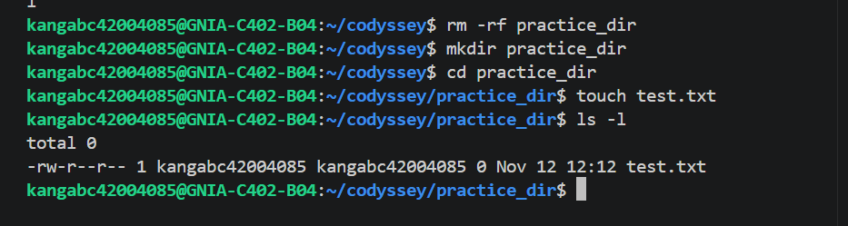

### 755 권한 변경

`chmod 755` 명령어로 `test.txt` 파일 권한을 변경했습니다.

```bash
chmod 755 test.txt
ls -l test.txt
```
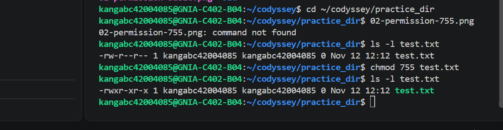

### 644 권한 변경

`chmod 644` 명령어로 `test.txt` 파일 권한을 변경했습니다.

```bash
chmod 644 test.txt
ls -l test.txt
```
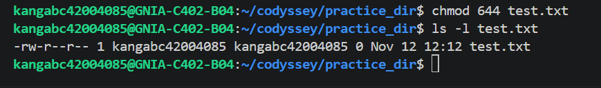

## Docker 설치 확인

Docker가 정상적으로 설치되었는지 확인했습니다.

```bash
docker --version
```

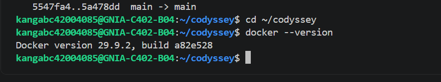

```bash
docker run hello-world
```

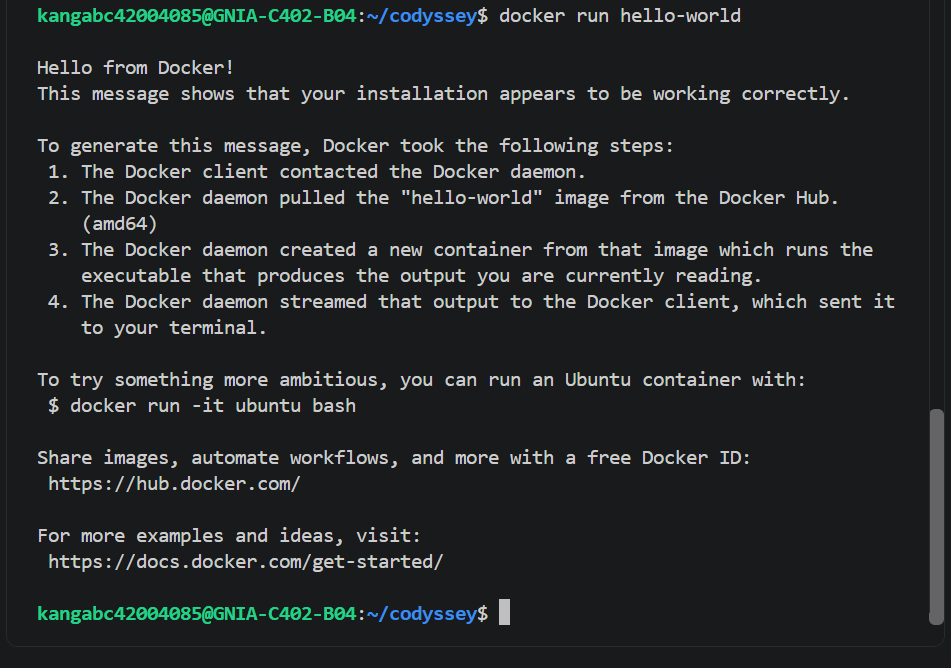

### Docker 정보 확인

Docker 실행 환경이 정상적으로 구성되어 있는지 확인하기 위해 `docker info` 명령어를 실행했습니다.

```bash
docker info
```

실행 결과 Docker Client와 Server가 모두 정상적으로 동작 중임을 확인했습니다.

```text
Client Version: 29.9.2
Context: desktop-linux
Server Version: 29.9.2
Containers: 8
Running: 2
Paused: 0
Stopped: 6
Images: 10
Storage Driver: overlayfs
Operating System: Docker Desktop
OSType: linux
Architecture: x86_64
CPUs: 24
Total Memory: 15.25GiB
```

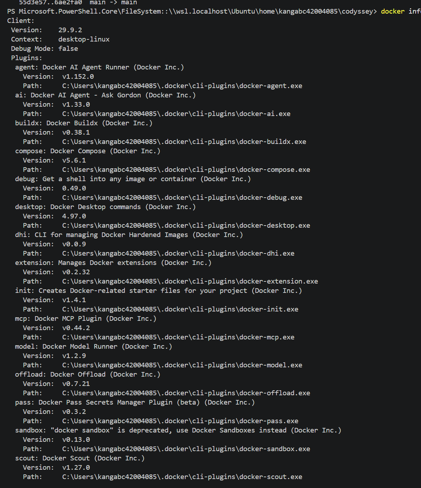
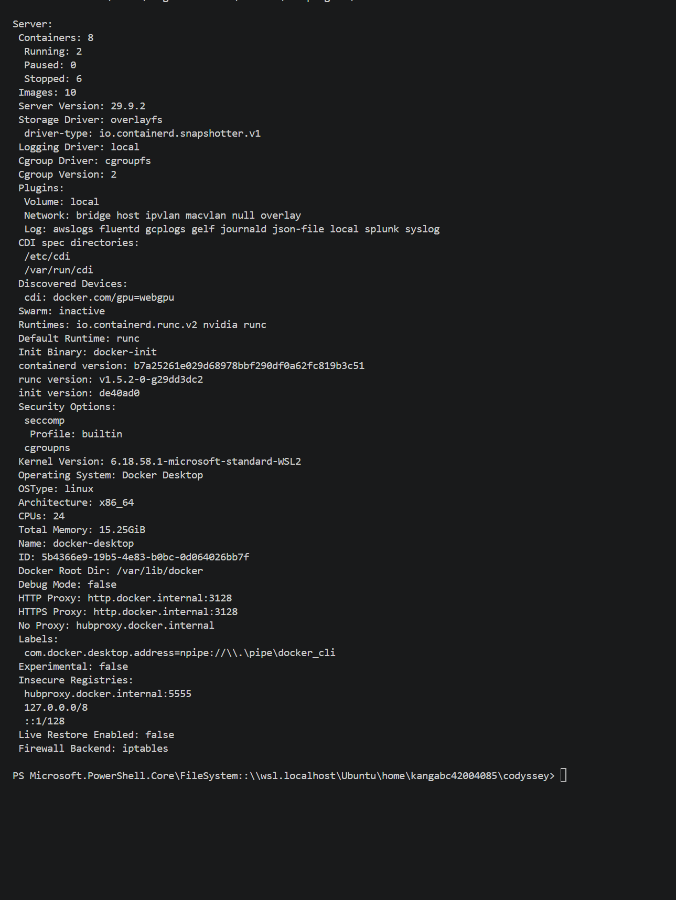

## Dockerfile 웹 서버 실행

Dockerfile을 사용하여 nginx 기반 웹 서버 이미지를 빌드하고 컨테이너로 실행했습니다.

```dockerfile
FROM nginx:latest

COPY ./app /usr/share/nginx/html

EXPOSE 80
```

이미지 빌드 명령어는 다음과 같습니다.

```bash
docker build -t codyssey-web .
```

컨테이너 실행 및 웹 서버 접속 확인 명령어는 다음과 같습니다.

```bash
docker run -d --name codyssey-web -p 8080:80 codyssey-web
docker ps
curl http://localhost:8080
```

실행 결과 `curl http://localhost:8080` 명령어를 통해 HTML 파일이 정상적으로 반환되는 것을 확인했습니다.

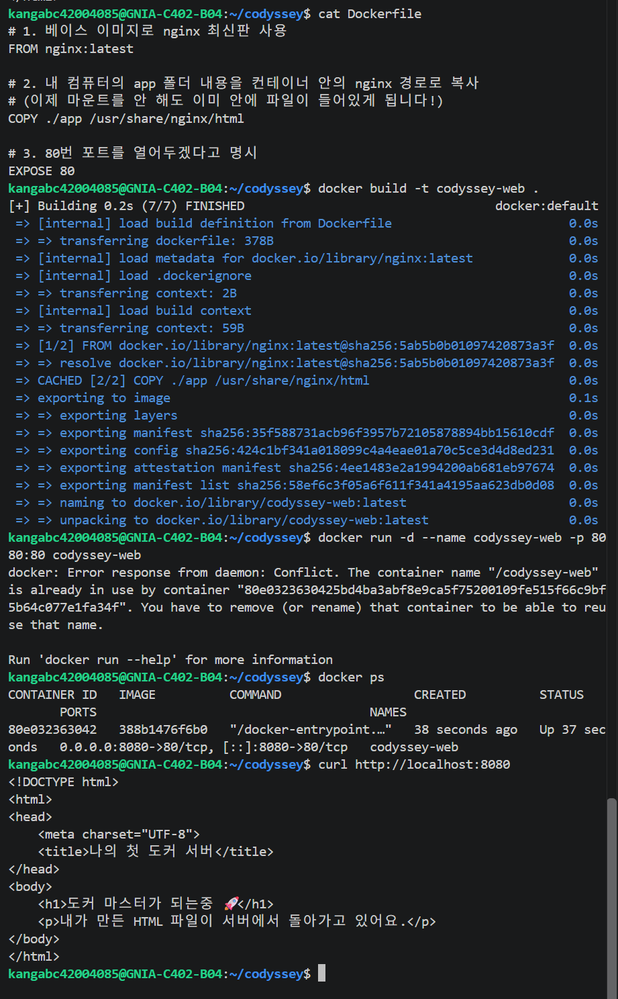

## Docker 볼륨 영속성 확인

Docker volume을 생성하고 nginx 컨테이너에 연결했습니다.

```bash
docker volume create codyssey-volume
docker volume ls
```

생성한 볼륨을 nginx 컨테이너의 웹 루트 디렉터리에 연결했습니다.

```bash
docker run -d --name volume-test -p 8080:80 -v codyssey-volume:/usr/share/nginx/html nginx:latest
```

컨테이너 내부의 `/usr/share/nginx/html/index.html` 파일에 테스트 HTML을 작성했습니다.

```bash
docker exec volume-test sh -c "echo '<h1>Docker Volume Persistence Test</h1>' > /usr/share/nginx/html/index.html"
curl.exe http://localhost:8080
```

실행 결과, 브라우저 또는 curl 명령을 통해 다음 HTML이 출력되는 것을 확인했습니다.

```html
<h1>Docker Volume Persistence Test</h1>
```

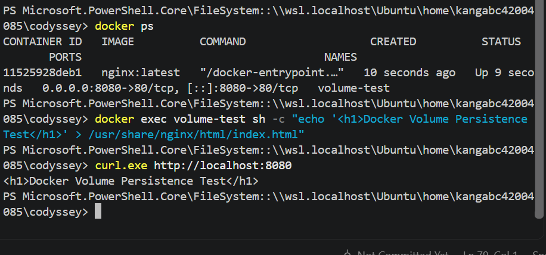

이후 기존 컨테이너를 삭제하고 같은 Docker volume을 새 컨테이너에 다시 연결했습니다.

```bash
docker rm -f volume-test
docker run -d --name volume-test-2 -p 8080:80 -v codyssey-volume:/usr/share/nginx/html nginx:latest
curl.exe http://localhost:8080
```

컨테이너를 삭제한 뒤에도 동일한 HTML 내용이 출력되었습니다.  
이를 통해 Docker volume에 저장된 데이터가 컨테이너 삭제 후에도 유지됨을 확인했습니다.

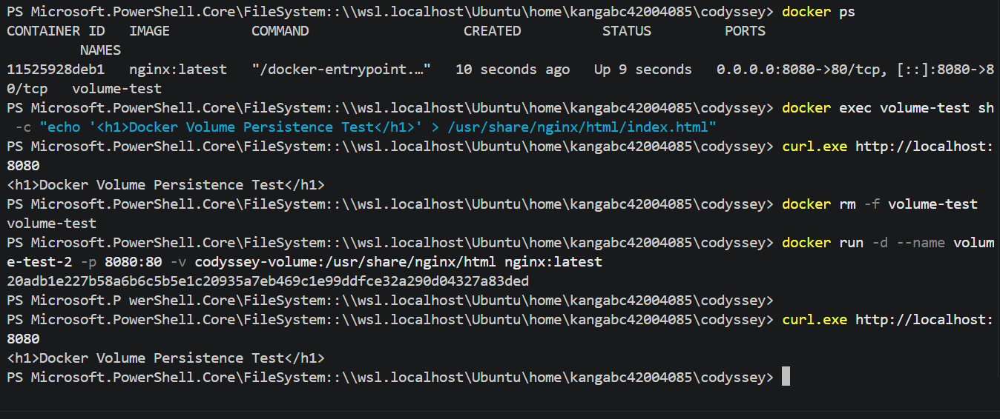

## 트러블슈팅

### 1. Docker 웹 서버 포트 접속 실패

#### 문제
Dockerfile로 nginx 웹 서버 이미지를 빌드하고 컨테이너를 실행했지만, 처음에는 브라우저에서 웹 페이지가 정상적으로 보이지 않았다.

#### 원인 가설
컨테이너 내부에서는 nginx가 `80` 포트로 실행되지만, 호스트 PC의 포트와 컨테이너 포트가 제대로 연결되지 않았을 가능성이 있다고 판단했다.

#### 확인
실행 중인 컨테이너의 상태와 포트 매핑 정보를 확인했다.

```bash
docker ps
docker ps -a
```

`PORTS` 항목에서 다음과 같이 호스트 포트와 컨테이너 포트가 연결되어 있는지 확인했다.

```text
0.0.0.0:8080->80/tcp
```

#### 해결
컨테이너 실행 시 `-p` 옵션을 사용하여 호스트의 `8080` 포트와 컨테이너의 `80` 포트를 연결했다.

```bash
docker run -d -p 8080:80 --name web-server nginx
```

또는 직접 빌드한 이미지를 사용한 경우 다음과 같이 실행했다.

```bash
docker run -d -p 8080:80 --name web-server my-nginx
```

#### 결과
포트 매핑 후 브라우저 또는 `curl` 명령어로 접속했을 때 웹 서버가 정상적으로 응답하는 것을 확인했다.

```bash
curl http://localhost:8080
```


---

### 2. README 이미지가 GitHub에서 표시되지 않는 문제

#### 문제
README.md에 스크린샷 이미지를 추가했지만, GitHub에서 이미지가 깨져서 표시되는 문제가 있었다.

#### 원인 가설
README에 작성한 이미지 경로와 실제 이미지 파일명이 일치하지 않거나, 이미지 파일이 GitHub 저장소에 커밋되지 않았을 가능성이 있다고 판단했다.

#### 확인
먼저 프로젝트 폴더와 `images` 폴더의 파일 목록을 확인했다.

```bash
ls
ls images
```

그다음 Git 상태를 확인하여 이미지 파일이 Git에 추가되었는지 확인했다.

```bash
git status
```

README의 이미지 경로도 실제 파일명과 같은지 확인했다.


### 해결

이미지 파일을 `images/` 폴더에 정리하고, README의 이미지 경로를 실제 파일명과 일치하도록 수정했다.

수정 후 변경사항을 Git에 추가하고 커밋한 뒤 GitHub에 push했다.

```bash
git add README.md images/
git commit -m "Fix README image links"
git push
```

#### 결과
GitHub 저장소의 README에서 스크린샷 이미지가 정상적으로 표시되는 것을 확인했다.


---

### 3. Docker 컨테이너 이름 중복 문제

#### 문제
컨테이너를 다시 실행하려고 할 때 기존에 사용했던 컨테이너 이름과 중복되어 새 컨테이너가 실행되지 않는 문제가 발생할 수 있었다.

#### 원인 가설
Docker에서는 컨테이너가 중지된 상태여도 이름이 남아 있다. 따라서 기존 컨테이너와 같은 이름을 다시 사용하면 이름 충돌이 발생한다.

#### 확인
전체 컨테이너 목록을 확인했다.

```bash
docker ps -a
```

출력 결과에서 기존 컨테이너 이름을 확인했다.

```text
NAMES
web-server
```

#### 해결
기존 컨테이너가 필요하지 않은 경우 삭제했다.

```bash
docker rm web-server
```

만약 실행 중인 컨테이너라면 먼저 중지한 뒤 삭제했다.

```bash
docker stop web-server
docker rm web-server
```

또는 새 컨테이너 실행 시 다른 이름을 사용했다.

```bash
docker run -d -p 8081:80 --name web-server-2 nginx
```

#### 결과
기존 컨테이너 이름 충돌을 해결한 뒤 새 컨테이너를 정상적으로 실행할 수 있었다.

```bash
docker ps -a
```

## Git 버전 확인

개발 환경에서 Git이 정상적으로 설치되어 있는지 확인하기 위해 Git 버전을 확인했습니다.

```bash
git --version
```

실행 결과 Git 버전이 정상적으로 출력되는 것을 확인했습니다.

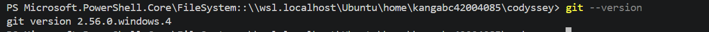

---

## Docker 운영 명령 확인

Docker 이미지, 컨테이너 상태, 로그, 리소스 사용량을 확인하기 위해 Docker 운영 명령어를 실행했습니다.

### Docker 이미지 목록 확인

```bash
docker images
```

Docker에 저장된 이미지 목록을 확인했습니다.

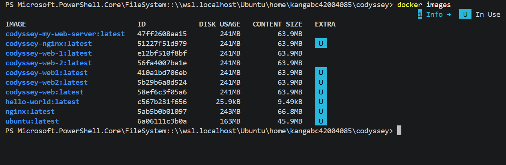

### Docker 컨테이너 목록 확인

```bash
docker ps -a
```

실행 중이거나 중지된 전체 컨테이너 목록을 확인했습니다.

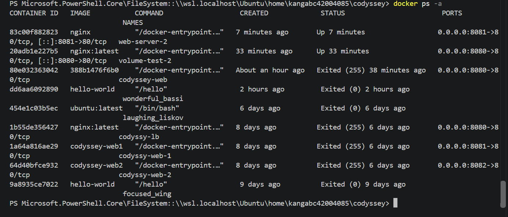

### Docker 컨테이너 로그 확인

```bash
docker logs web-server-2
```

웹 서버 컨테이너의 실행 로그를 확인했습니다.

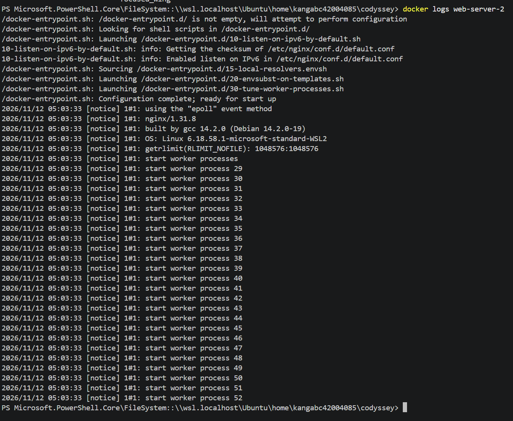

### Docker 컨테이너 리소스 사용량 확인

```bash
docker stats
```

실행 중인 컨테이너의 CPU, 메모리, 네트워크 사용량을 확인했습니다.  
`docker stats` 명령은 실시간으로 계속 실행되므로 확인 후 `Ctrl + C`로 종료했습니다.

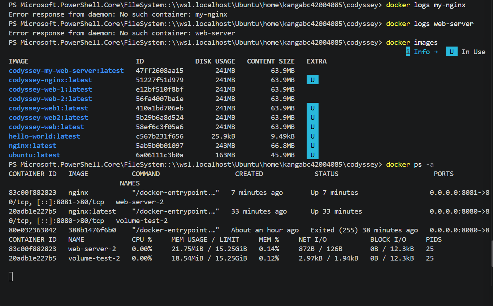


---

# 평가 보완 내용 정리

## 1. 파일 이동(mv) 및 삭제(rm) 실행 기록

파일 생성뿐만 아니라 파일 이동과 삭제 명령어도 함께 정리했다.

```bash
touch move-test.txt
ls -l move-test.txt
mv move-test.txt moved-test.txt
ls -l moved-test.txt
rm moved-test.txt
ls -l moved-test.txt
```

각 명령어의 의미는 다음과 같다.

| 명령어 | 의미 |
|---|---|
| `touch move-test.txt` | 빈 파일 생성 |
| `ls -l move-test.txt` | 생성된 파일 확인 |
| `mv move-test.txt moved-test.txt` | 파일 이름 변경 또는 이동 |
| `ls -l moved-test.txt` | 변경된 파일 확인 |
| `rm moved-test.txt` | 파일 삭제 |
| `ls -l moved-test.txt` | 삭제 여부 확인 |

삭제 후에는 다음과 같이 파일이 없다는 메시지가 출력될 수 있다.

```text
ls: cannot access 'moved-test.txt': No such file or directory
```

이는 `rm` 명령어로 파일이 정상적으로 삭제되었음을 의미한다.

---

## 2. chmod 권한 숫자와 rwx 의미

Linux 파일 권한에서 `rwx`는 각각 다음 의미를 가진다.

| 표시 | 의미 |
|---|---|
| `r` | read, 읽기 권한 |
| `w` | write, 쓰기 권한 |
| `x` | execute, 실행 권한 |

권한 숫자는 각 권한에 해당하는 값을 더해서 표현한다.

| 권한 | 숫자 |
|---|---:|
| `r` | 4 |
| `w` | 2 |
| `x` | 1 |

예를 들어 `755`는 다음과 같다.

| 대상 | 숫자 | 권한 | 의미 |
|---|---:|---|---|
| 소유자 | 7 | `rwx` | 읽기, 쓰기, 실행 가능 |
| 그룹 | 5 | `r-x` | 읽기, 실행 가능 |
| 기타 사용자 | 5 | `r-x` | 읽기, 실행 가능 |

`644`는 다음과 같다.

| 대상 | 숫자 | 권한 | 의미 |
|---|---:|---|---|
| 소유자 | 6 | `rw-` | 읽기, 쓰기 가능 |
| 그룹 | 4 | `r--` | 읽기 가능 |
| 기타 사용자 | 4 | `r--` | 읽기 가능 |

따라서 `chmod 755 test.txt`는 소유자에게 모든 권한을 주고, 그룹과 기타 사용자에게는 읽기와 실행 권한을 주는 설정이다.

```bash
chmod 755 test.txt
```

`chmod 644 test.txt`는 일반 텍스트 파일에 자주 사용하는 권한으로, 소유자는 읽기와 쓰기가 가능하고 그룹과 기타 사용자는 읽기만 가능하다.

```bash
chmod 644 test.txt
```

---

## 3. Docker 설치 및 데몬 상태 확인

Docker가 설치되어 있는지 확인하기 위해 다음 명령어를 사용했다.

```bash
docker --version
docker info
```

`docker --version`은 Docker 클라이언트 버전을 확인하는 명령어이다.

예시 출력은 다음과 같다.

```text
Docker version 29.0.2, build ...
```

`docker info`는 Docker 클라이언트와 서버, 즉 Docker 데몬 상태를 확인하는 명령어이다.  
이 명령어가 정상적으로 출력되면 Docker 데몬이 실행 중이며, 현재 시스템에서 Docker 명령을 사용할 수 있다는 의미이다.

---

## 4. Docker hello-world 실행 결과

Docker 설치가 정상인지 확인하기 위해 `hello-world` 이미지를 실행했다.

```bash
docker run hello-world
```

정상적으로 실행되면 다음과 같은 메시지가 출력된다.

```text
Hello from Docker!
This message shows that your installation appears to be working correctly.
```

이 메시지는 Docker가 이미지를 가져오고, 컨테이너를 생성하고, 컨테이너 내부 프로그램을 실행하는 과정이 정상적으로 동작했다는 의미이다.

---

## 5. Docker 이미지 및 컨테이너 목록 확인

Docker 이미지 목록을 확인하기 위해 다음 명령어를 사용했다.

```bash
docker images
```

이 명령어는 로컬 환경에 저장된 Docker 이미지 목록을 보여준다.

또한 모든 컨테이너 목록을 확인하기 위해 다음 명령어를 사용했다.

```bash
docker ps -a
```

`docker ps -a`는 실행 중인 컨테이너뿐만 아니라 중지된 컨테이너까지 모두 보여준다.

| 명령어 | 의미 |
|---|---|
| `docker images` | 로컬 이미지 목록 확인 |
| `docker ps` | 실행 중인 컨테이너 확인 |
| `docker ps -a` | 전체 컨테이너 확인 |

---

## 6. Dockerfile 작성 및 docker build 실행 기록

프로젝트 루트에 다음과 같은 `Dockerfile`을 작성했다.

```dockerfile
FROM nginx:latest
COPY ./app /usr/share/nginx/html
```

각 명령어의 의미는 다음과 같다.

| 명령어 | 의미 |
|---|---|
| `FROM nginx:latest` | nginx 최신 이미지를 기반 이미지로 사용 |
| `COPY ./app /usr/share/nginx/html` | 로컬의 `app` 폴더 내용을 컨테이너 내부 nginx 웹 루트로 복사 |

작성한 Dockerfile을 기반으로 이미지를 빌드하기 위해 다음 명령어를 실행했다.

```bash
docker build -t codyssey-web .
```

명령어의 의미는 다음과 같다.

| 부분 | 의미 |
|---|---|
| `docker build` | Dockerfile을 사용해 이미지 빌드 |
| `-t codyssey-web` | 이미지 이름을 `codyssey-web`으로 지정 |
| `.` | 현재 디렉터리를 빌드 컨텍스트로 사용 |

빌드가 정상적으로 완료되면 다음과 비슷한 출력이 나타난다.

```text
Successfully built ...
Successfully tagged codyssey-web:latest
```

또는 Docker BuildKit 환경에서는 다음과 같은 출력이 나타날 수 있다.

```text
writing image sha256:...
naming to docker.io/library/codyssey-web:latest
```

빌드 후 이미지가 생성되었는지 확인하기 위해 다음 명령어를 사용했다.

```bash
docker images
```

이미지 목록에 `codyssey-web`이 표시되면 Docker 이미지 빌드가 정상적으로 완료된 것이다.

---

## 7. 웹 서버 컨테이너 실행 및 curl 응답 확인

빌드한 이미지를 컨테이너로 실행하기 위해 다음 명령어를 사용했다.

```bash
docker run -d --name codyssey-web -p 8080:80 codyssey-web
```

각 옵션의 의미는 다음과 같다.

| 옵션 | 의미 |
|---|---|
| `-d` | 백그라운드에서 컨테이너 실행 |
| `--name codyssey-web` | 컨테이너 이름 지정 |
| `-p 8080:80` | 호스트 8080 포트를 컨테이너 80 포트와 연결 |
| `codyssey-web` | 실행할 이미지 이름 |

컨테이너 실행 후 다음 명령어로 웹 서버 응답을 확인했다.

```bash
curl http://localhost:8080
```

정상적으로 연결되면 `app/index.html`에 작성한 HTML 내용이 출력된다.  
이는 호스트 PC의 `8080` 포트로 들어온 요청이 컨테이너 내부 nginx의 `80` 포트로 전달되었다는 뜻이다.

---

## 8. Docker 볼륨 영속성 확인 및 inspect 기록

Docker 볼륨은 컨테이너가 삭제되어도 데이터를 유지하기 위해 사용한다.

볼륨을 생성하기 위해 다음 명령어를 사용했다.

```bash
docker volume create codyssey-volume
```

생성된 볼륨 목록은 다음 명령어로 확인할 수 있다.

```bash
docker volume ls
```

볼륨의 상세 정보는 다음 명령어로 확인할 수 있다.

```bash
docker volume inspect codyssey-volume
```

`docker volume inspect`는 볼륨 이름, 드라이버, 마운트 위치 등의 상세 정보를 출력한다.

예시 출력 구조는 다음과 같다.

```json
[
  {
    "CreatedAt": "...",
    "Driver": "local",
    "Labels": null,
    "Mountpoint": "...",
    "Name": "codyssey-volume",
    "Options": null,
    "Scope": "local"
  }
]
```

컨테이너가 삭제되어도 볼륨은 별도로 유지되기 때문에, 같은 볼륨을 다시 연결하면 이전 데이터가 남아 있는지 확인할 수 있다.

---

## 9. Git 설정 및 GitHub 원격 저장소 확인

Git 버전 확인뿐만 아니라 Git 설정과 원격 저장소 연결 상태도 확인했다.

```bash
git --version
git config --list
git remote -v
```

각 명령어의 의미는 다음과 같다.

| 명령어 | 의미 |
|---|---|
| `git --version` | Git 설치 여부와 버전 확인 |
| `git config --list` | Git 설정 목록 확인 |
| `git remote -v` | 연결된 원격 저장소 확인 |

`git config --list`에서는 사용자 이름, 이메일, 기본 브랜치 등의 설정을 확인할 수 있다.

예시:

```text
user.name=example-user
user.email=example@example.com
init.defaultbranch=main
```

`git remote -v`는 현재 로컬 저장소가 어떤 GitHub 저장소와 연결되어 있는지 보여준다.

예시:

```text
origin  https://github.com/example-user/example-repo.git (fetch)
origin  https://github.com/example-user/example-repo.git (push)
```

이를 통해 로컬 저장소와 GitHub 원격 저장소가 연결되어 있음을 확인할 수 있다.

---

## 10. 프로젝트 폴더 구조와 역할

프로젝트의 기본 폴더 구조는 다음과 같다.

```text
codyssey/
├── README.md
├── Dockerfile
├── app/
│   └── index.html
└── images/
```

각 파일과 폴더의 역할은 다음과 같다.

| 경로 | 역할 |
|---|---|
| `README.md` | 미션 수행 과정, 명령어, 결과, 트러블슈팅을 정리한 문서 |
| `Dockerfile` | Docker 이미지를 만들기 위한 설정 파일 |
| `app/` | nginx 웹 서버에서 제공할 웹 파일 저장 폴더 |
| `app/index.html` | 브라우저에 표시될 HTML 파일 |
| `images/` | 실행 결과 이미지나 참고 자료를 저장하는 폴더 |

Dockerfile에서 사용한 다음 명령어는 `app` 폴더를 nginx의 웹 루트로 복사한다.

```dockerfile
COPY ./app /usr/share/nginx/html
```

즉, 로컬의 `app/index.html` 파일이 컨테이너 내부의 `/usr/share/nginx/html/index.html` 위치로 복사되고, nginx가 이 파일을 웹 페이지로 제공한다.

---

## 11. 포트 충돌 시 확인 및 해결 방법

컨테이너 실행 시 이미 사용 중인 포트를 지정하면 포트 충돌이 발생할 수 있다.

예를 들어 `8080` 포트가 이미 사용 중이면 다음과 같은 오류가 발생할 수 있다.

```text
port is already allocated
```

먼저 실행 중인 컨테이너를 확인한다.

```bash
docker ps -a
```

필요 없는 컨테이너가 포트를 사용 중이라면 중지하고 삭제한다.

```bash
docker stop codyssey-web
docker rm codyssey-web
```

Windows에서는 다음 명령어로 특정 포트를 사용하는 프로세스를 확인할 수 있다.

```bash
netstat -ano | findstr :8080
```

8080 포트를 사용할 수 없다면 다른 호스트 포트를 사용해 컨테이너를 실행할 수 있다.

```bash
docker run -d --name codyssey-web-2 -p 8081:80 codyssey-web
```

이 경우 접속 주소는 다음과 같다.

```text
http://localhost:8081
```

---

## 12. Docker 이미지와 컨테이너의 차이

Docker 이미지는 컨테이너를 만들기 위한 실행 템플릿이다.  
애플리케이션 코드, 실행 환경, 설정 파일 등이 포함될 수 있다.

Docker 컨테이너는 이미지를 실제로 실행한 상태이다.  
즉, 이미지는 설계도이고 컨테이너는 그 설계도를 바탕으로 실행된 인스턴스라고 볼 수 있다.

| 구분 | 이미지 | 컨테이너 |
|---|---|---|
| 의미 | 실행 템플릿 | 실행 중인 인스턴스 |
| 상태 | 정적인 파일 묶음 | 실행되거나 중지될 수 있는 환경 |
| 생성 | `docker build` | `docker run` |
| 삭제 영향 | 컨테이너 삭제와 별개로 유지 가능 | 삭제하면 실행 상태와 변경 내용이 사라질 수 있음 |

이번 실습에서는 다음 순서로 작업했다.

```bash
docker build -t codyssey-web .
docker run -d --name codyssey-web -p 8080:80 codyssey-web
```

즉, 먼저 이미지를 만들고 그 이미지를 기반으로 컨테이너를 실행했다.

---

## 13. Docker 네트워크 네임스페이스와 포트 포워딩

Docker 컨테이너는 기본적으로 호스트 PC와 분리된 네트워크 환경에서 실행된다.  
이처럼 컨테이너마다 독립적으로 분리된 네트워크 공간을 네트워크 네임스페이스라고 볼 수 있다.

nginx는 컨테이너 내부에서 `80` 포트로 실행된다.  
하지만 컨테이너 내부 포트는 호스트 PC에서 바로 접근할 수 없기 때문에 호스트 포트와 컨테이너 포트를 연결해야 한다.

실습에서는 다음 명령어를 사용했다.

```bash
docker run -d --name codyssey-web -p 8080:80 codyssey-web
```

`-p 8080:80`의 의미는 다음과 같다.

| 구분 | 포트 | 의미 |
|---|---:|---|
| 호스트 포트 | 8080 | 내 PC에서 접속하는 포트 |
| 컨테이너 포트 | 80 | 컨테이너 내부 nginx가 사용하는 포트 |

따라서 브라우저나 curl로 다음 주소에 접속하면,

```text
http://localhost:8080
```

호스트의 `8080` 포트로 들어온 요청이 Docker에 의해 컨테이너 내부의 `80` 포트로 전달된다.

즉, 포트 포워딩은 분리된 호스트 네트워크와 컨테이너 네트워크를 연결하는 역할을 한다.

---

## 14. Dockerfile에서 상대경로와 절대경로 사용 기준

Dockerfile에는 다음과 같은 명령어를 작성했다.

```dockerfile
COPY ./app /usr/share/nginx/html
```

여기서 `./app`은 상대경로이다.  
상대경로는 현재 작업 위치를 기준으로 파일이나 폴더를 지정하는 방식이다.

```text
./app
```

위 경로는 Docker build를 실행하는 프로젝트 루트 기준의 `app` 폴더를 의미한다.

반면 `/usr/share/nginx/html`은 절대경로이다.  
절대경로는 파일 시스템의 최상위 경로 `/`부터 시작하는 전체 경로이다.

```text
/usr/share/nginx/html
```

이 경로는 nginx 컨테이너 내부에서 웹 파일이 위치하는 기본 디렉터리이다.

정리하면 다음과 같다.

| 경로 | 종류