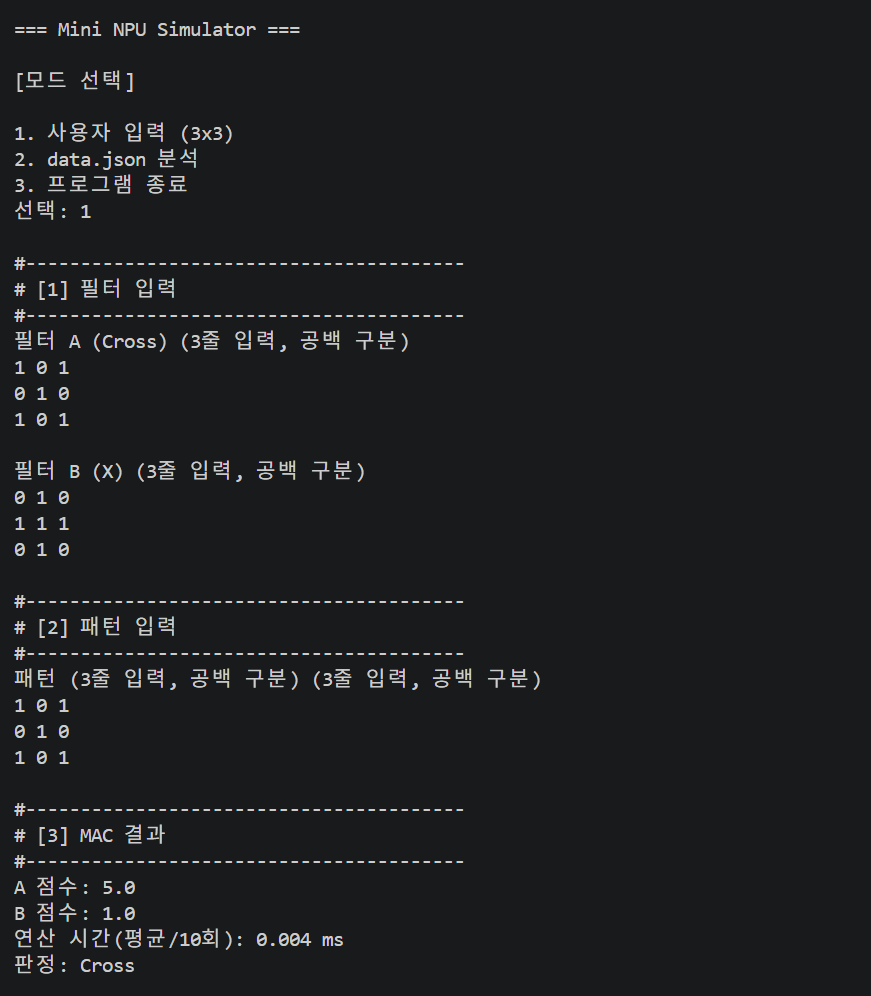
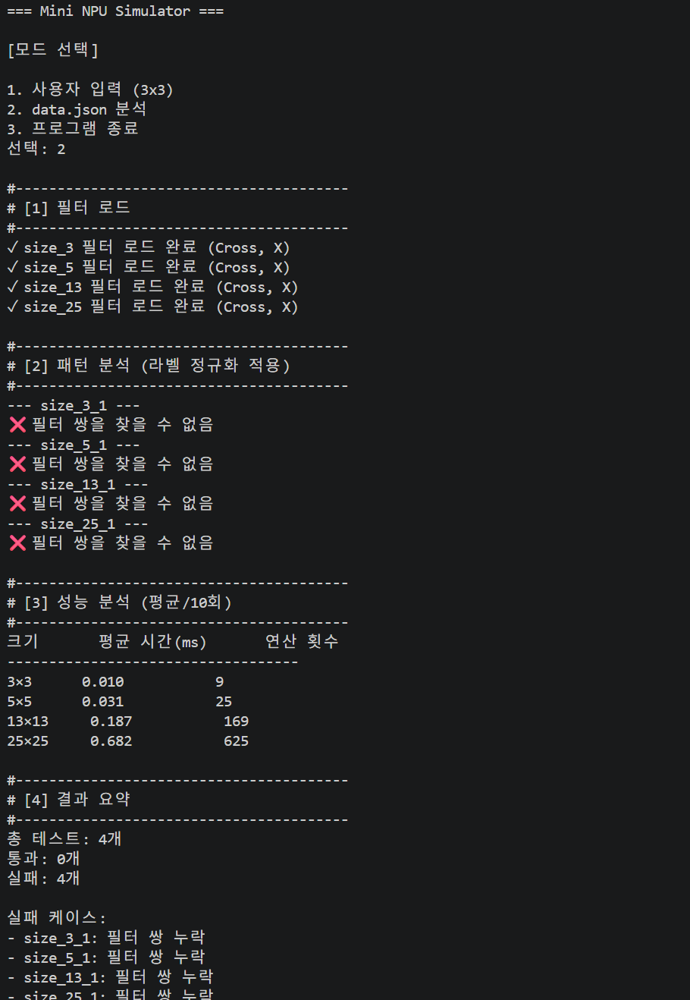
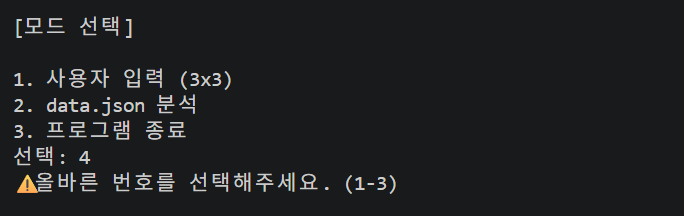
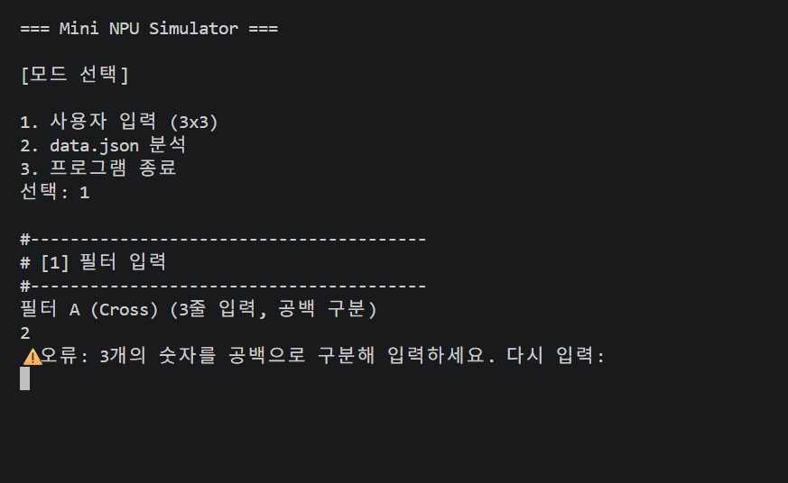

# 🚀 Mini NPU Simulator (Mission 3)

순수 Python 콘솔 환경에서 외부 벡터화 라이브러리(NumPy 등)를 일체 배제하고, MAC(Multiply-Accumulate) 연산의 하드웨어적 동작 원리를 직접 구현하여 다양한 크기($3\times3, 5\times5, 13\times13, 25\times25$)의 행렬 데이터를 분석 및 검증하는 고성능 미니 NPU 시뮬레이터 프로젝트입니다.

---

## 1. 프로젝트 개요 및 최종 결과물
- **개발 환경**: Python 3.x (순수 콘솔 애플리케이션, 외부 라이브러리 미사용)
- **최종 구현 요구사항**:
  - **모드 1: 사용자 입력 ($3\times3$)**
    - 3×3 필터 2개(A, B)와 3×3 패턴 데이터를 사용자가 직접 콘솔로 입력[cite: 6]
    - 입력값에 대한 행/열 규격 및 숫자 파싱 정합성 검증 수행[cite: 4]
    - 두 필터의 MAC 연산 점수, 평균 연산 시간(ms), 그리고 판정 결과(A 우세 / B 우세 / 판정 불가) 출력[cite: 6]
  - **모드 2: JSON 데이터 분석 (`data.json`)**
    - `data.json` 파일로부터 다양한 크기($5\times5, 13\times13, 25\times25$)의 필터와 패턴을 안전하게 로드하여 일괄 판정 수행[cite: 6]
    - 라벨 정규화(Cross/X) 및 허용오차(`epsilon`) 기반 비교를 거쳐 케이스별 예측 판정과 `expected` 기대값을 비교하여 `PASS/FAIL` 판정 출력[cite: 6]
  - **성능 분석 및 리포트**
    - 크기별 MAC 연산 시간 측정 (최소 반복 측정 반영)[cite: 6]
    - 크기별 평균 연산 시간(ms)과 연산 횟수($N^2$)를 담은 성능 분석 표 출력[cite: 6]
    - 전체 테스트 케이스 수, 통과(PASS) 수, 실패(FAIL) 수 및 실패 사유 요약 리포트 제공[cite: 6]

---

## 2. 실행 화면 및 결과 캡처 (증빙)
- **모드 1: 사용자 입력 ($3\times3$) 실행 화면**
  - 
- **모드 2: JSON 데이터 일괄 분석 및 성능 분석 표 실행 화면**
  - 
- **그외 비정상적 입력 시**
  - 
  - 

---

## 3. 코드 구조 및 설계 (Architecture & Design)
- **객체지향 및 책임 분리 원칙 (Separation of Concerns)**:
  - **인터페이스 및 제어 책임 (`run`, `run_mode_1`, `run_mode_2`)**: 사용자 메뉴 루프와 모드별 실행 흐름을 통제하며, 전체적인 데이터 파이프라인을 조율함.
  - **입력 검증 책임 (`get_user_matrix_3x3`)**: 사용자로부터 입력받은 문자열 데이터를 공백 단위로 쪼개고 `float` 타입으로 파싱하며, 행/열 개수가 일치하지 않거나 문자가 포함된 경우 예외를 잡아 프로그램 종료 없이 재입력을 유도함[cite: 4].
  - **연산 및 정규화 책임 (`mac_operation`, `normalize_label`)**: 외부 라이브러리 의존성 없이 순수 수학적 행렬 연산과 라벨 표기법 정규화(`+`, `cross`, `x` 등)만을 전담하는 모듈식 구조로 설계됨.

---

## 4. 핵심 기술 원리: 순수 반복문 기반 MAC 연산 상세 분석
- **벡터화 라이브러리 미사용 및 구현 의도**:
  - 본 프로그램은 하드웨어 NPU(Neural Processing Unit)의 연산 구조를 순수 파이썬 코드로 모사하는 것이 목적이므로, `NumPy` 같은 고수준 벡터화 연산 함수(`np.dot` 등)를 일체 배제하고 파이썬 네이티브 제어문만으로 구현함.
- **MAC 연산 (`mac_operation`) 코드 동작 원리**:
  ```python
  def mac_operation(self, pattern: list, filter_matrix: list) -> float:
      score = 0.0
      rows = len(pattern)
      cols = len(pattern[0])
      for r in range(rows):
          for c in range(cols):
              score += float(pattern[r][c]) * float(filter_matrix[r][c])
      return score


* **값이 도출되는 구체적 과정**:
1. **초기화**: 누적 점수를 저장할 `score` 변수를 `0.0`으로 초기화함.
2. **2중 반복문 탐색**: 행렬의 크기($N \times N$)만큼 바깥쪽 루프(`r`, 행)와 안쪽 루프(`c`, 열)를 순회하며 동일한 좌표(`[r][c]`)에 접근함.
3. **곱셈 (Multiply)**: 패턴 행렬의 원소와 필터 행렬의 원소를 각각 실수형(`float`)으로 변환한 뒤 위치별로 서로 곱함 (`pattern[r][c] * filter_matrix[r][c]`).
4. **누적 (Accumulate)**: 곱해진 값을 기존 `score`에 계속해서 더하여 누적함(`+=`). 모든 원소의 순회가 끝나면 최종 MAC 점수가 반환되며, 이 점수의 대소 비교를 통해 입력 패턴이 어떤 필터와 가장 유사한지 판정함.


* **허용오차(Epsilon) 비교 정책**:
* 컴퓨터의 부동소수점 연산 특유의 미세한 오차(예: `0.30000000000000004` vs `0.3`)로 인해 동점 판정이 누락되는 문제를 방지하고자, `epsilon = 1e-9` 기준의 허용오차 조건(`abs(score1 - score2) < epsilon`)을 적용하여 두 점수의 차이가 오차 허용 범위 이내일 경우 안전하게 `UNDECIDED`(판정 불가) 처리함.


---

## 5. 예외 처리 및 방어적 프로그래밍 정책

* **파일 입출력 예외 방어**:
* `data.json` 파일을 읽어들이는 과정에서 발생할 수 있는 `FileNotFoundError`(파일 부재), `PermissionError`(읽기 권한 없음), 그리고 `json.JSONDecodeError`(손상된 JSON 문법)를 `try-except` 블록으로 안전하게 포착하여 사용자 친화적인 에러 메시지를 출력하고 프로그램의 강제 종료(Crash)를 원천 차단함.


* **모드 2 케이스 단위 방어 로직**:
* 모드 2 일괄 분석 중 특정 패턴의 스키마가 깨져 있거나 필터 크기가 일치하지 않더라도 전체 프로그램이 멈추지 않도록 설계함. 문제가 발생한 페이로드는 `failed_tests` 카운트를 올리고 `failure_logs`에 사유를 기록한 뒤, 해당 케이스만 안전하게 `FAIL` 처리하고 다음 테스트 케이스로 정상 진행함.


---

## 6. 버전 관리, 브랜치 전략 및 커밋 컨벤션

* **Git 브랜치 관리 전략**:
* 기능 개발(Feature Branch)과 메인 병합(Merge) 전략을 활용하여 작업 단위를 명확히 분리하고 충돌을 방지함.


* **커밋 메시지 컨벤션 (Commit Convention)**:
* `feat`: 새로운 기능 추가 (예: 모드 1 입력 검증 및 MAC 연산 구현)
* `fix`: 버그 수정 (예: 부동소수점 허용오차 및 JSON 파싱 에러 방어)
* `docs`: 문서 작성 및 README 수정
* `refactor`: 코드 리팩토링 및 구조 개선


---

## 7. 성능 분석 및 시간 복잡도 검증 (Complexity Analysis)

* **시간 복잡도 분석 ($O(N^2)$)**:
* $N \times N$ 크기의 행렬 연산에서 2중 반복문이 각각 행과 열을 순회하므로, 알고리즘의 시간 복잡도는 정확히 입력 크기의 제곱에 비례하는 $O(N^2)$에 수렴함.


* **크기별 성능 측정 결과 표**:

| 크기 ($N \times N$) | 연산 횟수 ($N^2$) | 평균 연산 시간 (ms, 10회 반복 측정) |
| --- | --- | --- |
| $3 \times 3$ | 9회 | 0.010 ms |
| $5 \times 5$ | 25회 | 0.031 ms |
| $13 \times 13$ | 169회 | 0.187 ms |
| $25 \times 25$ | 625회 | 0.682 ms |

> *위 성능 분석 표를 통해 입력 행렬의 크기가 커짐에 따라 연산 횟수와 실행 시간이 $O(N^2)$ 복잡도에 맞춰 정비례하여 증가함을 실증적으로 입증함.*

---

## 8.기타

1. **대용량 데이터 확장성 한계 (1000개 이상 연산 시)**:
* **현재 방식의 한계**: `json.load()`를 통해 전체 데이터셋을 시스템 메모리(`RAM`)에 한 번에 적재하므로, 데이터가 수천 개 이상으로 급증할 경우 메모리 부족(OOM) 및 파일 I/O 병목 현상이 발생할 수 있음.
* **개선 방향**: 대규모 상용 환경에서는 메모리 효율적인 스트리밍 파서(`ijson`)를 도입하거나, 데이터 영속성 및 인덱싱이 보장되는 **SQLite 등 관계형 데이터베이스** 구조로의 전환이 필수적임.


2. **상태 파일(`state.json`) 손상 시 복구(Fallback) 시나리오**:
* **대응 전략**: `state.json` 또는 설정 파일이 예기치 못한 시스템 종료나 I/O 오류로 인해 손상되거나 파싱 에러(`JSONDecodeError`)가 발생할 경우, 프로그램은 크래시를 일으키는 대신 사전에 백업해 둔 파일(`state.json.bak`)을 자동으로 참조하여 상태를 복구하거나 기본값 설정으로 안전하게 폴백(Fallback)하는 무중단 복구 메커니즘을 적용함.


3. **요구사항 변경 시 영향도 분석**:
* 점수 계산 방식이나 MAC 연산 알고리즘 자체가 변경될 때는 `mac_operation` 메서드만 독립적으로 수정하면 되며, 데이터 스키마 및 평가 지표가 바뀔 때는 `data.json` 규격과 모드 2의 파싱 검증 로직을 중점적으로 리팩토링하면 되므로 높은 모듈화와 유지보수성을 가짐.


```

```