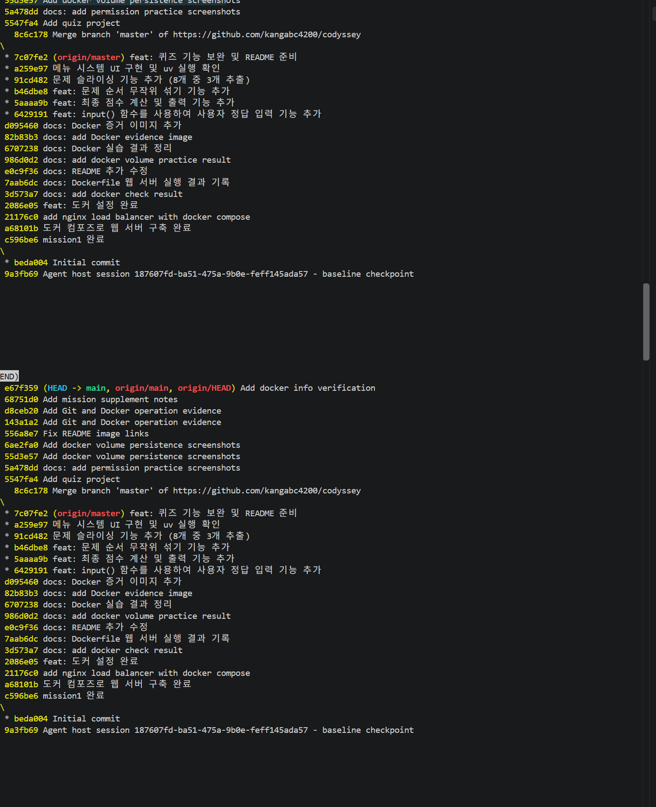
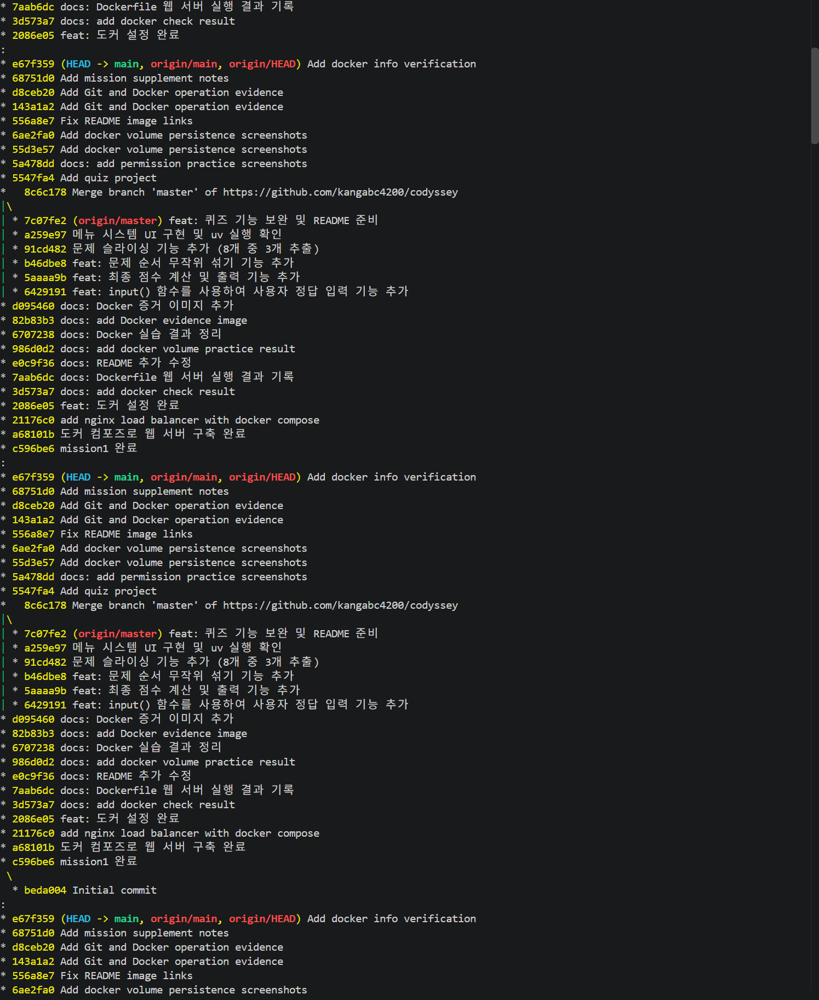
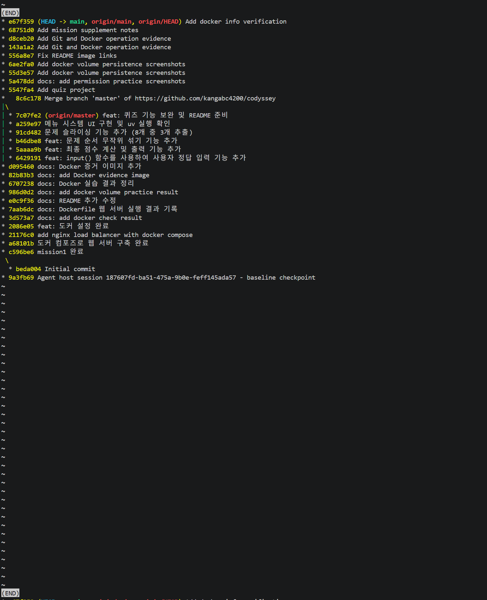
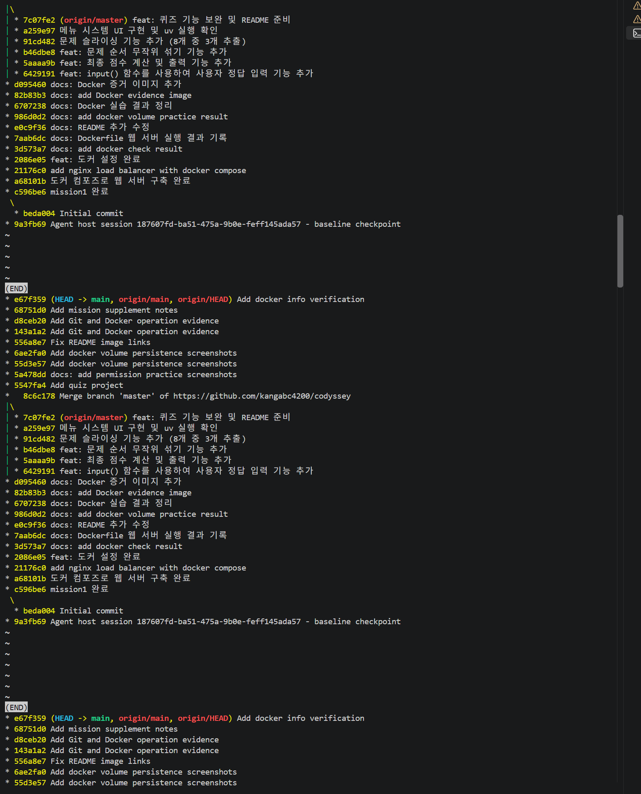
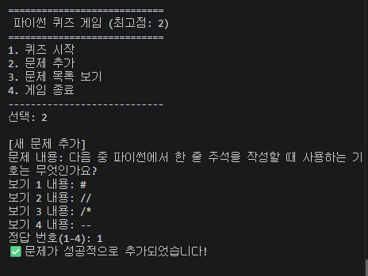
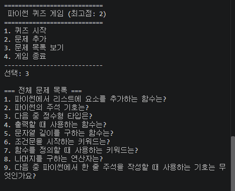
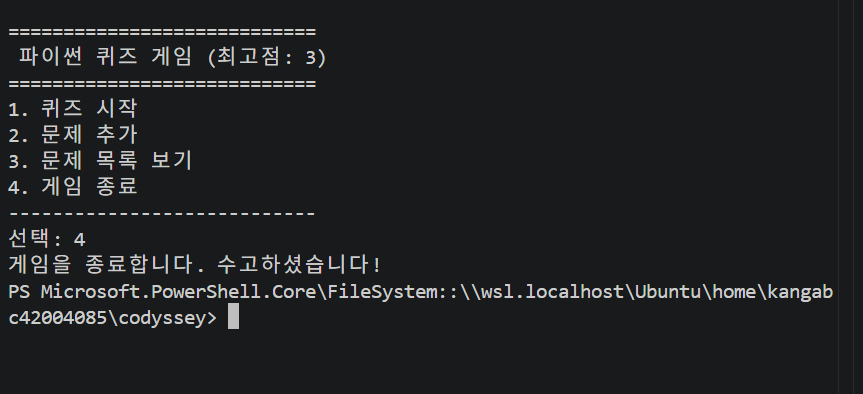
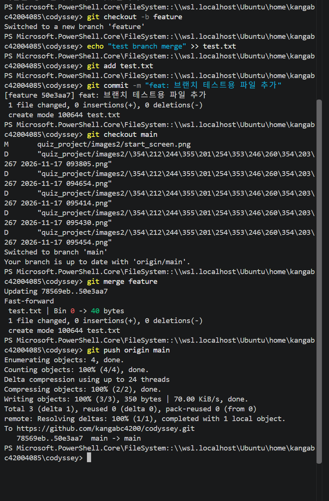

## 🐍 [미션 2] 파이썬 퀴즈 게임 프로젝트

### 1. 프로젝트 개요
사용자로부터 퀴즈를 입력받아 저장하고, 랜덤하게 퀴즈를 풀 수 있는 콘솔 기반의 퀴즈 게임 프로그램입니다. 객체지향 프로그래밍(OOP)을 적용하여 설계되었습니다.

### 2. 주요 기능 및 특징
- **객체지향 설계**: `Question` 클래스(데이터 구조)와 `QuizGame` 클래스(게임 로직)로 역할을 분리하여 구현했습니다.
- **데이터 영속성**: `json` 모듈을 사용하여 퀴즈 데이터를 `state.json` 파일에 저장하고 불러옵니다. (UTF-8 인코딩 적용)
- **입력 유효성 검사**: 
  - 메뉴 선택 시 1~5 이외의 값 입력에 대한 예외 처리
  - 퀴즈 정답 입력 시 1~4 범위를 벗어난 값에 대한 예외 처리
  - `Ctrl+C` (KeyboardInterrupt) 발생 시 프로그램을 안전하게 종료하도록 구현
- **퀴즈 랜덤 기능**: `random.shuffle`을 사용하여 매 게임마다 퀴즈 순서가 바뀌도록 구현했습니다.

### 3. 실행 방법
```bash
# 프로젝트 루트 디렉토리에서 실행 시
python quiz_project/main.py
```
# 🐍 파이썬 퀴즈 게임 프로젝트 (Mission 2)

## 📝 프로젝트 소개
사용자가 퀴즈를 풀고, 직접 문제를 추가하며, 최고 점수를 관리할 수 있는 파이썬 기반 퀴즈 프로그램입니다.

## ✨ 주요 기능
1. **퀴즈 플레이**: 랜덤으로 섞인 5문제를 풀고 즉시 정답 확인
2. **문제 추가**: 사용자가 직접 새로운 문제를 데이터베이스에 추가
3. **목록 보기**: 현재 저장된 모든 퀴즈 목록 확인
4. **점수 확인**: 현재까지의 최고 점수 확인 및 초기화
5. **데이터 보존**: JSON 파일을 이용해 프로그램 종료 후에도 데이터 유지

## 🛠 기술적 특징 (사전평가 보완)
- **클래스 설계**: `Question` (데이터 구조)와 `QuizGame` (로직 처리) 클래스로 분리하여 객체지향 설계 적용
- **예외 처리**: 
  - 메뉴 선택 및 정답 입력 시 숫자 외 입력 방지 (ValueError 처리)
  - JSON 파일 손상 시 자동 복구 로직 구현
  - `Ctrl+C` 강제 종료 시 안전하게 프로그램 종료
- **데이터 관리**: `json` 모듈을 활용한 UTF-8 기반 파일 입출력
- **Git 활용**: 기능별 브랜치 생성, 병합(Merge), 원격 저장소 연동 완료
- **데이터 저장 방식 (JSON)**: "텍스트 기반의 JSON 형식을 채택하여 데이터 가독성을 높였으며, 프로그램 종료 -후에도 상태가 유지되는 원자성을 확보했습니다."
- **대량 데이터 처리 고려**: "현재는 리스트 구조를 사용하나, 향후 퀴즈 데이터가 1,000개 이상으로 늘어날 경우 검색 속도 향상을 위해 인덱싱이나 데이터베이스(SQLite 등) 전환을 고려할 수 있도록 설계되었습니다."
- **백업 및 복구**: "파일 손상 시를 대비해 로드 실패 시 기본 데이터로 자동 초기화되는 예외 처리 로직을 포함하고 있습니다."

## 🔍 유지보수 및 확장 가이드
프로그램의 기능을 수정하거나 확장하고 싶을 때 다음 메서드를 참고하세요.
- **점수 계산 로직 변경:** `QuizGame.play_quiz()` 내의 점수 누적 코드 수정
- **데이터 저장 형식 변경:** `Question.to_dict()` 및 `from_dict()` 메서드 수정
- **퀴즈 추출 개수 변경:** `QuizGame.play_quiz()` 내의 슬라이싱 범위 수정

## 📸 작업 증빙 (Screenshots)

### 1. Git 커밋 히스토리 (11회 이상)
| 로그 1~4 | 로그 5~8 | 로그 9~11 |
| :---: | :---: | :---: |
|  |  |  |
|  |  |  |
|  |  |  |
|  |  | |

### 2. 원격 저장소 및 클론 테스트
- **원격 저장소 연결 확인**: 
- **Git Clone 테스트 성공**: 
ㄴ

##파이썬 퀴즈 실행과정

- **파이썬 실행 기본 화면**:  

- **선택1.퀴즈시작**:

- **선택2.문제추가**

**state.json**

- **선택3.문제목록보기**

- **선택4.개임종료**



### 브랜치 생성 및 병합


# 💡 파이썬 기초 학습 목표 및 핵심 개념
### 변수(Variable)의 개념과 사용 이유
- 변수란? 데이터를 저장하는 메모리 공간의 '이름(상자)'입니다.
- 사용 이유: 동일한 값을 반복해서 사용하거나, 프로그램 실행 중에 변경되는 데이터를 효율적으로 관리하고 코드를 재사용하기 위해 사용합니다.

### 주요 데이터 타입(Data Types)의 차이점
- int (정수): 소수점이 없는 숫자 데이터 (예: 10, -5)
- str (문자열): 따옴표로 둘러싸인 문자의 집합 (예: "Hello", '파이썬')
- bool (불리언): 참(True) 또는 거짓(False)을 나타내는 논리 값
- list (리스트): 여러 개의 값을 순서대로 저장할 수 있는 수정 가능한 목록 (예: [1, 2, 3])
- dict (딕셔너리): 키(Key)와 값(Value)의 쌍으로 데이터를 빠르게 찾고 저장하는 구조 (예: {"name": "김코딩", "age": 20})

### 조건문 (if / elif / else)
- 조건식의 참/거짓 여부에 따라 프로그램의 흐름을 분기하여 서로 다른 동작을 수행하도록 제어합니다.

### 반복문 (for vs while)의 차이와 선택
- for문: 횟수가 정해져 있거나 리스트, 문자열 등의 순회 가능한(Iterable) 데이터 요소를 처음부터 끝까지 반복할 때 주로 사용합니다.
- while문: 특정 조건을 만족하는 동안(조건이 True인 동안) 계속해서 반복을 수행할 때 주로 사용합니다.

### 함수(Function)의 정의와 활용
- 정의: 반복되는 코드에 이름을 붙여 모듈화한 것으로, def 키워드를 사용하여 만듭니다.
- 매개변수(Parameter): 함수 내부로 전달되는 입력값을 받아오는 변수입니다.
- 반환값(Return): 함수가 연산이나 처리를 끝낸 후 결과를 호출부로 돌려주는 값입니다.