## 🐍 [미션 2] 파이썬 퀴즈 게임 프로젝트

### 1. 프로젝트 개요
사용자로부터 퀴즈를 입력받아 저장하고, 랜덤하게 퀴즈를 풀 수 있는 콘솔 기반의 퀴즈 게임 프로그램입니다. 객체지향 프로그래밍(OOP)을 적용하여 설계되었습니다.

### 2. 주요 기능 및 특징
- **객체지향 설계**: `Question` 클래스(데이터 구조)와 `QuizGame` 클래스(게임 로직)로 역할을 분리하여 구현했습니다.
- **데이터 영속성**: `json` 모듈을 사용하여 퀴즈 데이터를 `state.json` 파일에 저장하고 불러옵니다. (UTF-8 인코딩 적용)
- **입력 유효성 검사**: 
  - 메뉴 선택 시 1~5 이외의 값 입력에 대한 예외 처리
  - 퀴즈 정답 입력 시 1~4 범위를 벗어난 값에 대한 예외 처리
  - `Ctrl+C` (KeyboardInterrupt) 발생 시 프로그램을 안전하게 종료하도록 구현
- **퀴즈 랜덤 기능**: `random.shuffle`을 사용하여 매 게임마다 퀴즈 순서가 바뀌도록 구현했습니다.

### 3. 실행 방법
```bash
# 프로젝트 루트 디렉토리에서 실행 시
python quiz_project/main.py
```
# 🐍 파이썬 퀴즈 게임 프로젝트 (Mission 2)

## 📝 프로젝트 소개
사용자가 퀴즈를 풀고, 직접 문제를 추가하며, 최고 점수를 관리할 수 있는 파이썬 기반 퀴즈 프로그램입니다.

## ✨ 주요 기능
1. **퀴즈 플레이**: 랜덤으로 섞인 5문제를 풀고 즉시 정답 확인
2. **문제 추가**: 사용자가 직접 새로운 문제를 데이터베이스에 추가
3. **목록 보기**: 현재 저장된 모든 퀴즈 목록 확인
4. **점수 확인**: 현재까지의 최고 점수 확인 및 초기화
5. **데이터 보존**: JSON 파일을 이용해 프로그램 종료 후에도 데이터 유지

## 🛠 기술적 특징 (사전평가 보완)
- **클래스 설계**: `Question` (데이터 구조)와 `QuizGame` (로직 처리) 클래스로 분리하여 객체지향 설계 적용
- **예외 처리**: 
  - 메뉴 선택 및 정답 입력 시 숫자 외 입력 방지 (ValueError 처리)
  - JSON 파일 손상 시 자동 복구 로직 구현
  - `Ctrl+C` 강제 종료 시 안전하게 프로그램 종료
- **데이터 관리**: `json` 모듈을 활용한 UTF-8 기반 파일 입출력
- **Git 활용**: 기능별 브랜치 생성, 병합(Merge), 원격 저장소 연동 완료

## 📸 작업 증빙 (Screenshots)

### 1. Git 커밋 히스토리 (11회 이상)
| 로그 1~4 | 로그 5~8 | 로그 9~11 |
| :---: | :---: | :---: |
| 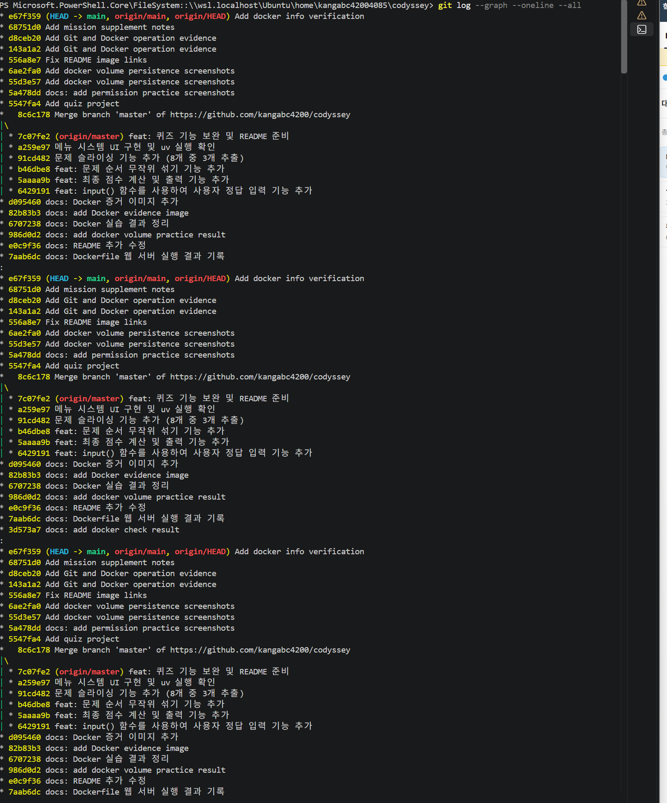 | 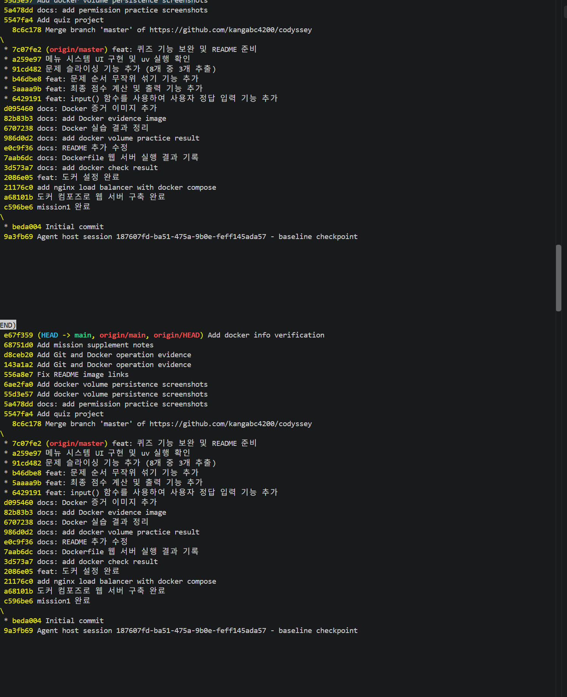 | 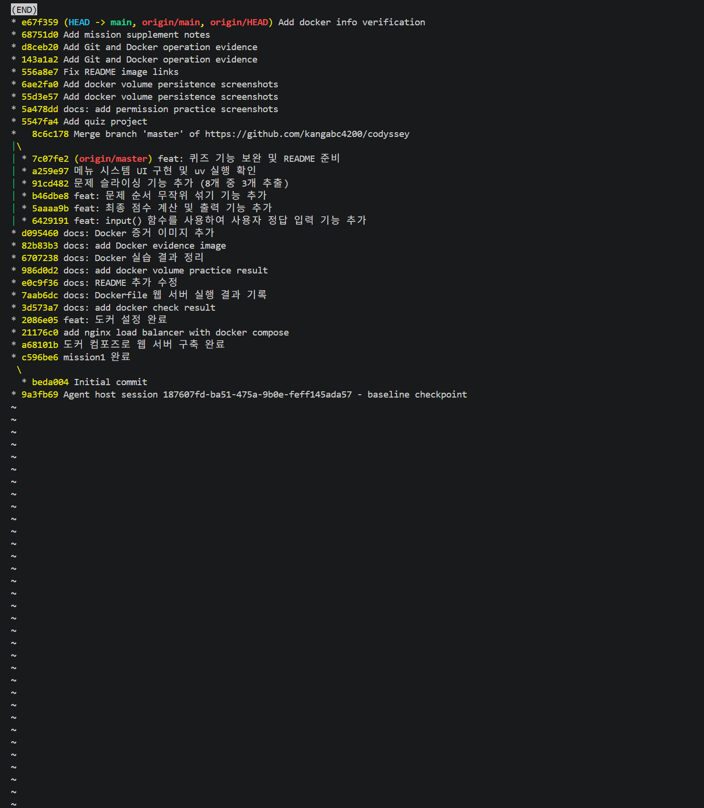 |
| 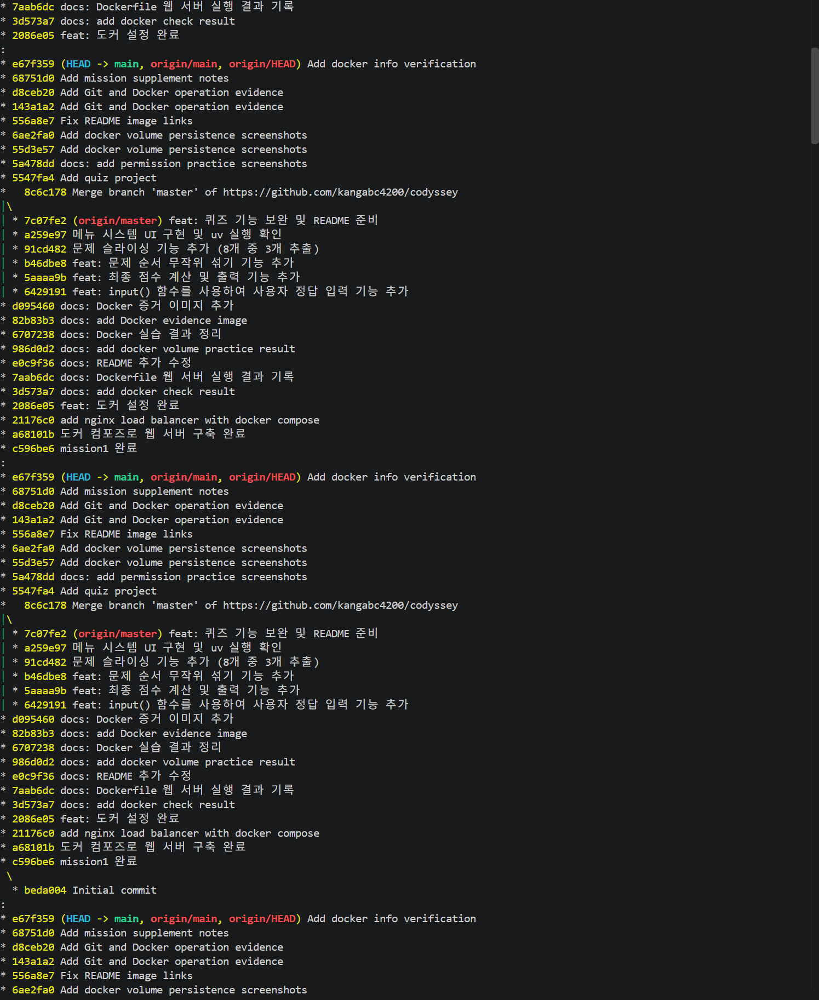 | 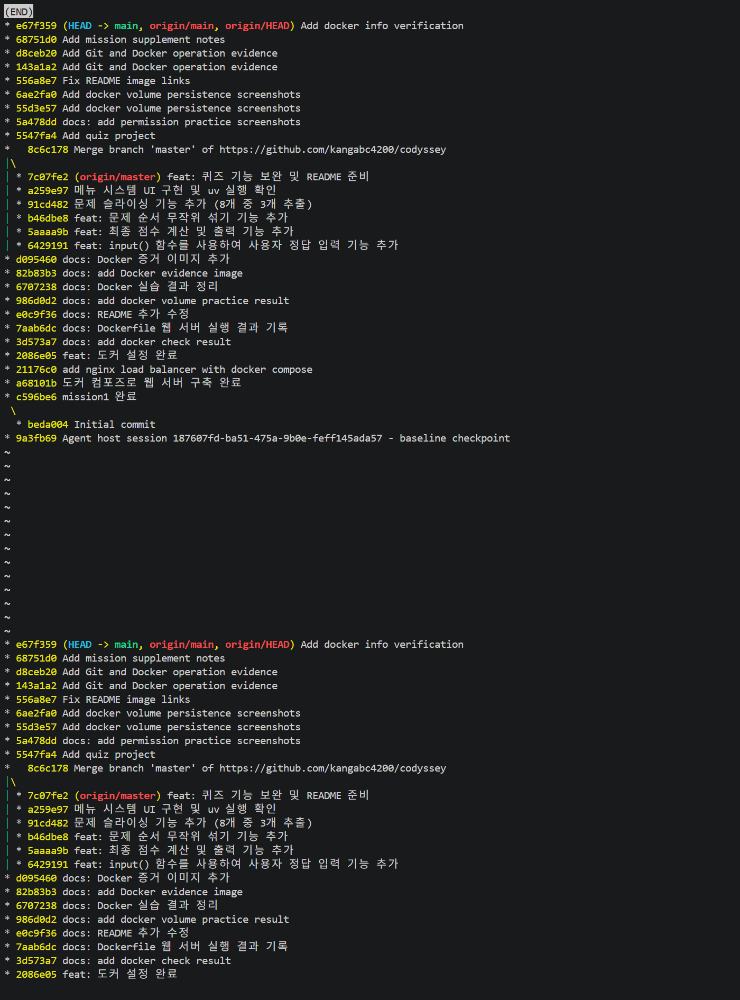 | 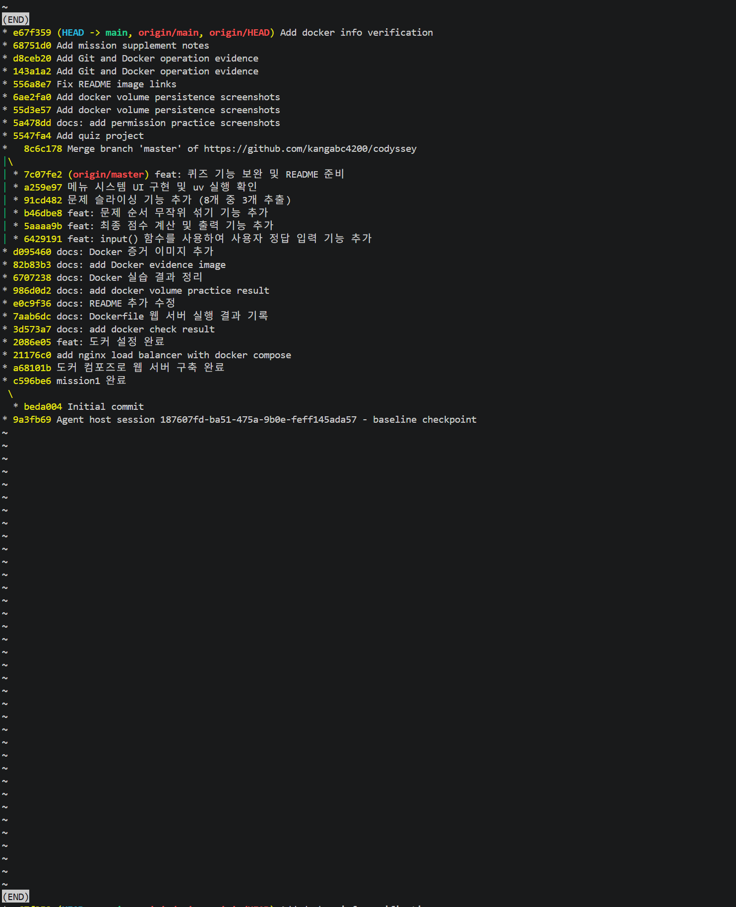 |
| 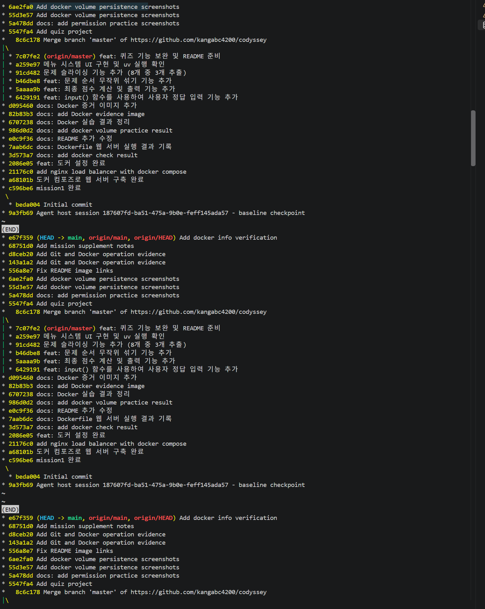 | 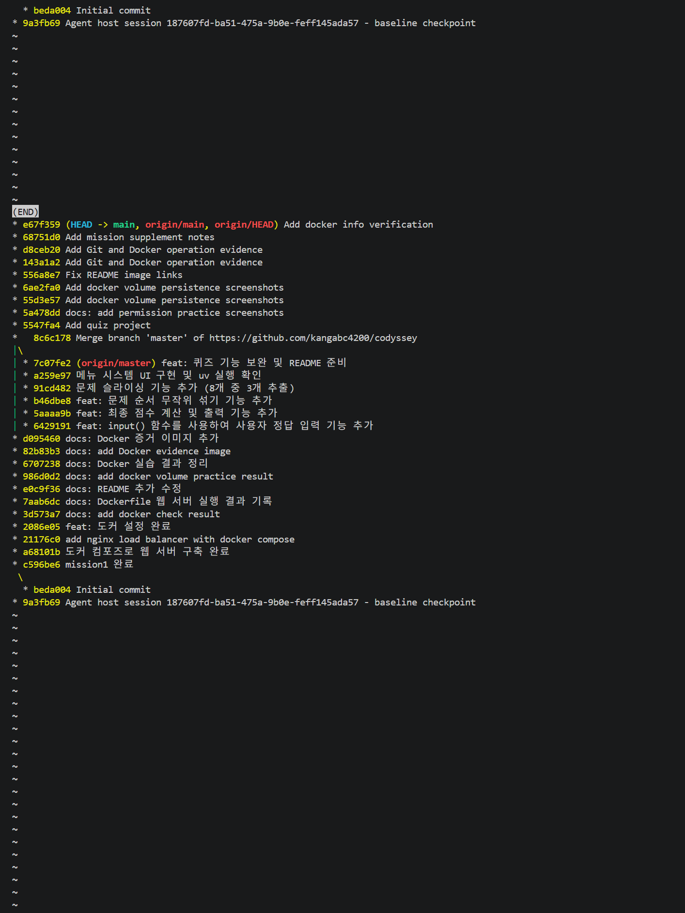 | 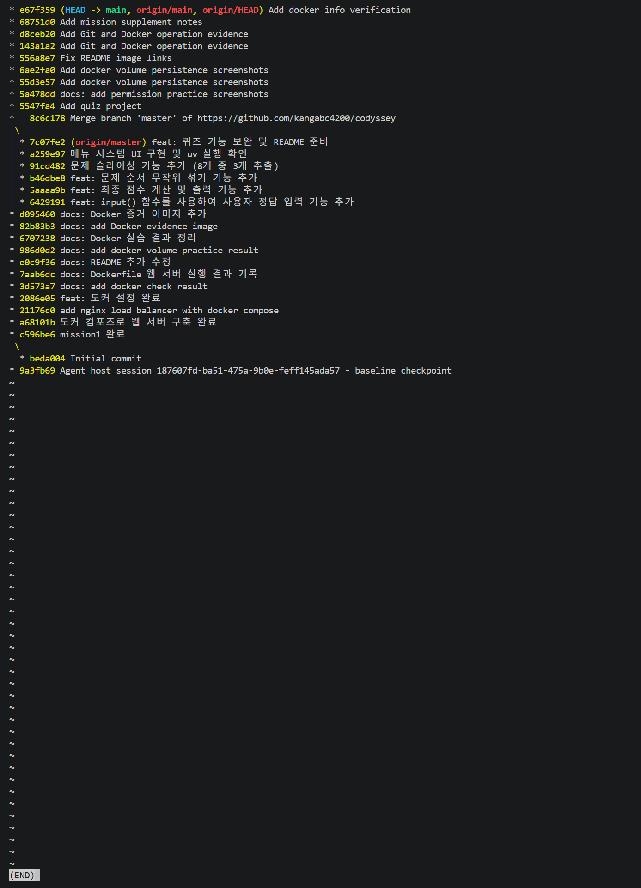 |
| 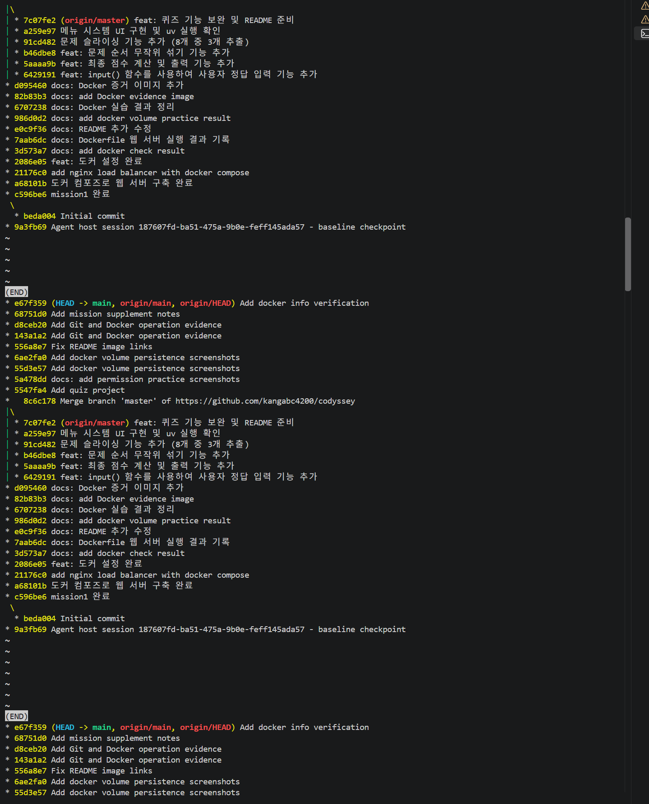 | 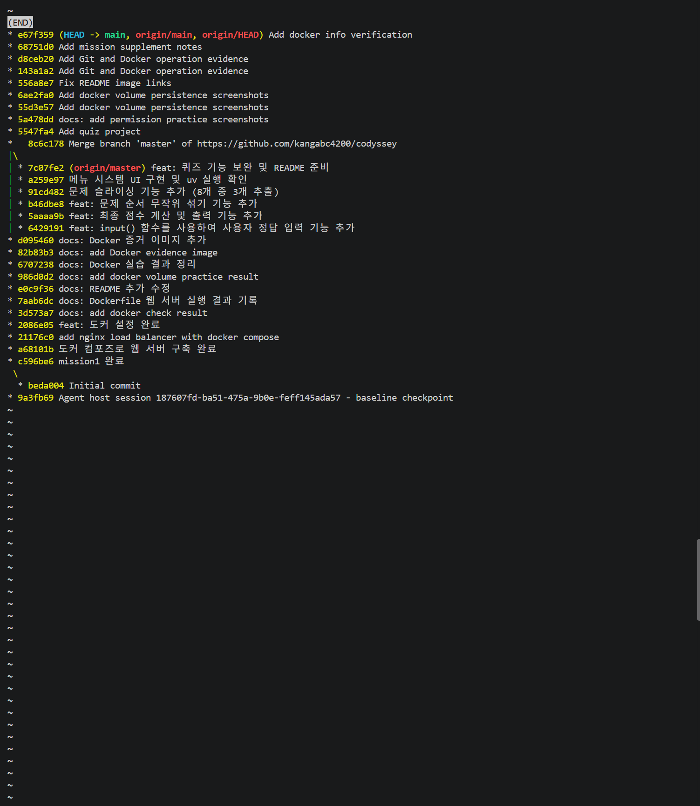 | |

### 2. 원격 저장소 및 클론 테스트
- **원격 저장소 연결 확인**: 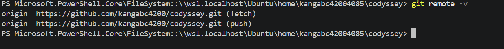
- **Git Clone 테스트 성공**: 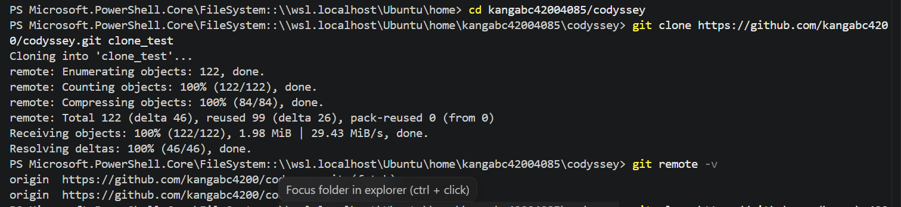