## 🐍 [미션 2] 파이썬 퀴즈 게임 프로젝트

### 1. 프로젝트 개요
사용자로부터 퀴즈를 입력받아 저장하고, 랜덤하게 퀴즈를 풀 수 있는 콘솔 기반의 퀴즈 게임 프로그램입니다. 객체지향 프로그래밍(OOP)을 적용하여 설계되었습니다.

### 2. 주요 기능 및 특징
- **객체지향 설계**: `Question` 클래스(데이터 구조)와 `QuizGame` 클래스(게임 로직)로 역할을 분리하여 구현했습니다.
- **데이터 영속성**: `json` 모듈을 사용하여 퀴즈 데이터를 `state.json` 파일에 저장하고 불러옵니다. (UTF-8 인코딩 적용)
- **입력 유효성 검사**: 
  - 메뉴 선택 시 1~5 이외의 값 입력에 대한 예외 처리
  - 퀴즈 정답 입력 시 1~4 범위를 벗어난 값에 대한 예외 처리
  - `Ctrl+C` (KeyboardInterrupt) 발생 시 프로그램을 안전하게 종료하도록 구현
- **퀴즈 랜덤 기능**: `random.shuffle`을 사용하여 매 게임마다 퀴즈 순서가 바뀌도록 구현했습니다.

### 3. 실행 방법
```bash
# 프로젝트 루트 디렉토리에서 실행 시
python quiz_project/main.py
```
# 🐍 파이썬 퀴즈 게임 프로젝트 (Mission 2)

## 📝 프로젝트 소개
사용자가 퀴즈를 풀고, 직접 문제를 추가하며, 최고 점수를 관리할 수 있는 파이썬 기반 퀴즈 프로그램입니다.

## ✨ 주요 기능
1. **퀴즈 플레이**: 랜덤으로 섞인 5문제를 풀고 즉시 정답 확인
2. **문제 추가**: 사용자가 직접 새로운 문제를 데이터베이스에 추가
3. **목록 보기**: 현재 저장된 모든 퀴즈 목록 확인
4. **점수 확인**: 현재까지의 최고 점수 확인 및 초기화
5. **데이터 보존**: JSON 파일을 이용해 프로그램 종료 후에도 데이터 유지

## 🛠 기술적 특징 (사전평가 보완)
- **클래스 설계**: `Question` (데이터 구조)와 `QuizGame` (로직 처리) 클래스로 분리하여 객체지향 설계 적용
- **예외 처리**: 
  - 메뉴 선택 및 정답 입력 시 숫자 외 입력 방지 (ValueError 처리)
  - JSON 파일 손상 시 자동 복구 로직 구현
  - `Ctrl+C` 강제 종료 시 안전하게 프로그램 종료
- **데이터 관리**: `json` 모듈을 활용한 UTF-8 기반 파일 입출력
- **Git 활용**: 기능별 브랜치 생성, 병합(Merge), 원격 저장소 연동 완료
- **데이터 저장 방식 (JSON)**: "텍스트 기반의 JSON 형식을 채택하여 데이터 가독성을 높였으며, 프로그램 종료 -후에도 상태가 유지되는 원자성을 확보했습니다."
- **대량 데이터 처리 고려**: "현재는 리스트 구조를 사용하나, 향후 퀴즈 데이터가 1,000개 이상으로 늘어날 경우 검색 속도 향상을 위해 인덱싱이나 데이터베이스(SQLite 등) 전환을 고려할 수 있도록 설계되었습니다."
- **백업 및 복구**: "파일 손상 시를 대비해 로드 실패 시 기본 데이터로 자동 초기화되는 예외 처리 로직을 포함하고 있습니다."

## 🔍 유지보수 및 확장 가이드
프로그램의 기능을 수정하거나 확장하고 싶을 때 다음 메서드를 참고하세요.
- **점수 계산 로직 변경:** `QuizGame.play_quiz()` 내의 점수 누적 코드 수정
- **데이터 저장 형식 변경:** `Question.to_dict()` 및 `from_dict()` 메서드 수정
- **퀴즈 추출 개수 변경:** `QuizGame.play_quiz()` 내의 슬라이싱 범위 수정

## 📸 작업 증빙 (Screenshots)

### 1. Git 커밋 히스토리 (11회 이상)
| 로그 1~4 | 로그 5~8 | 로그 9~11 |
| :---: | :---: | :---: |
| 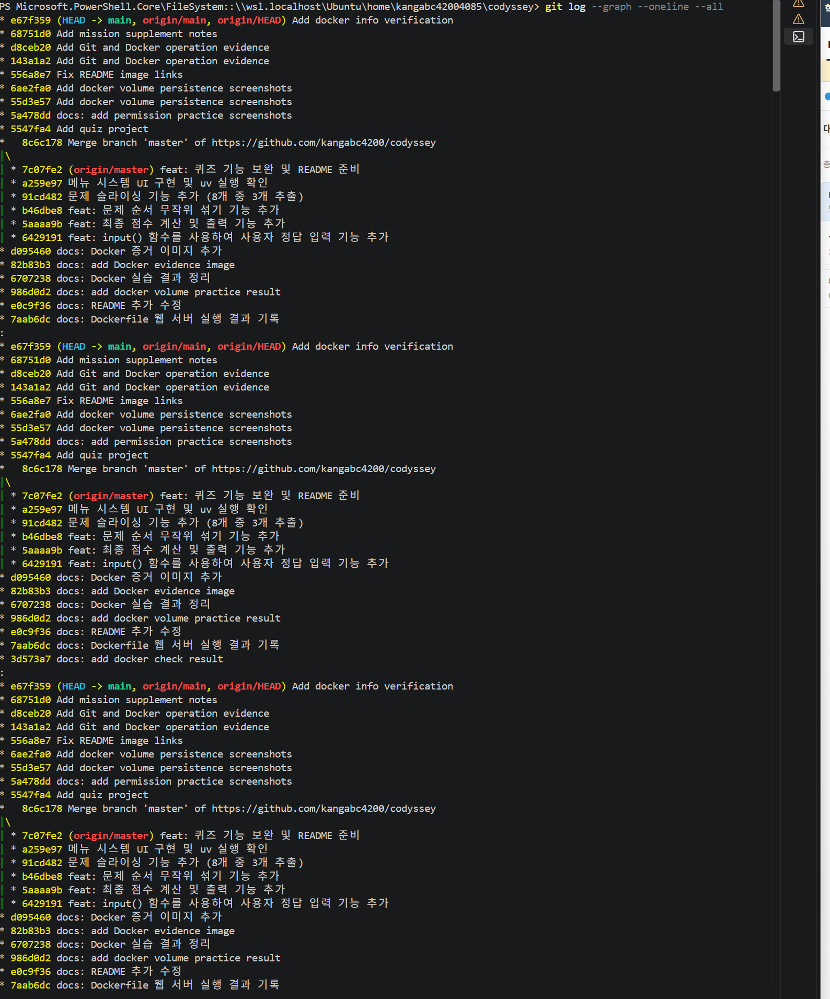 |  | 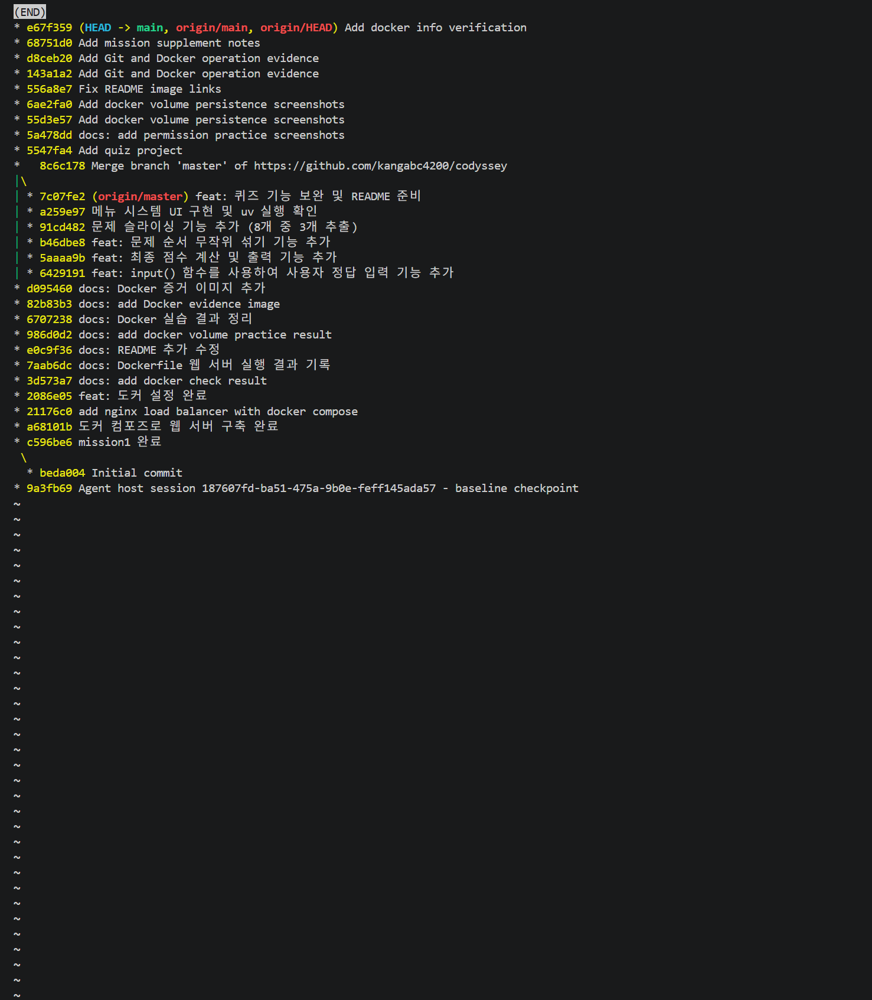 |
|  | 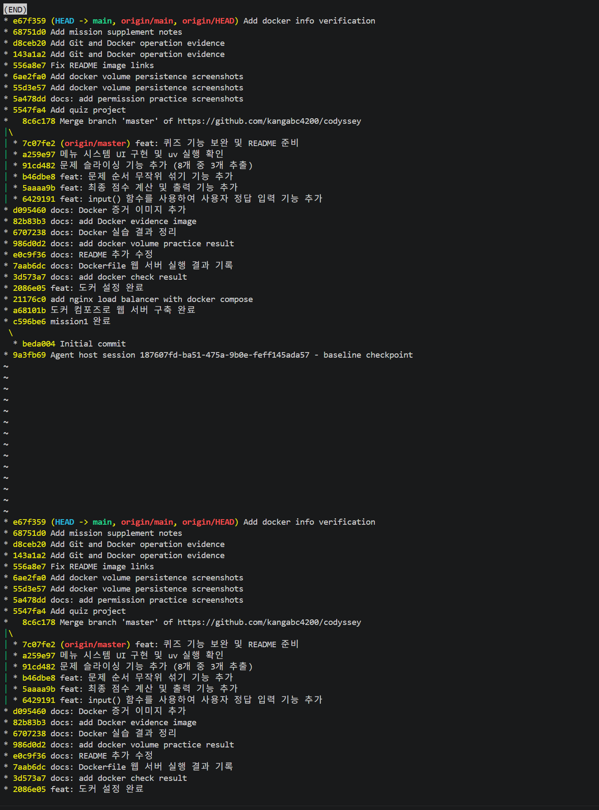 |  |
| 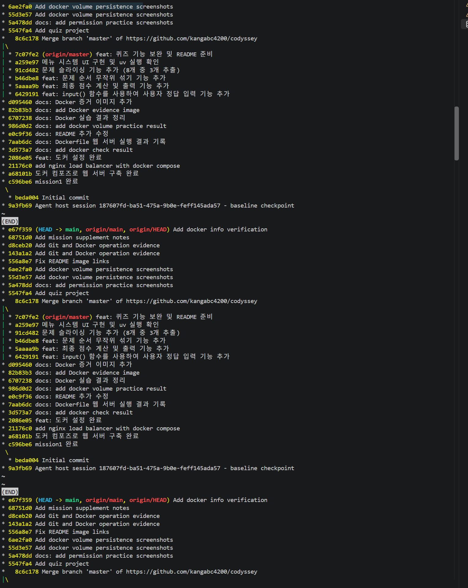 | 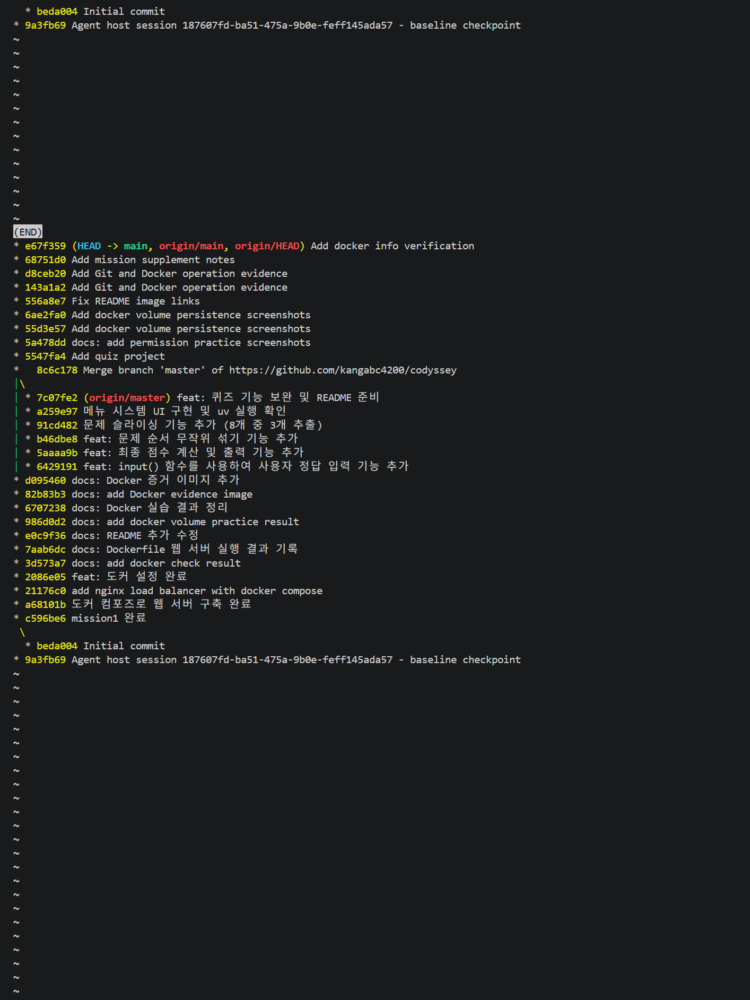 | 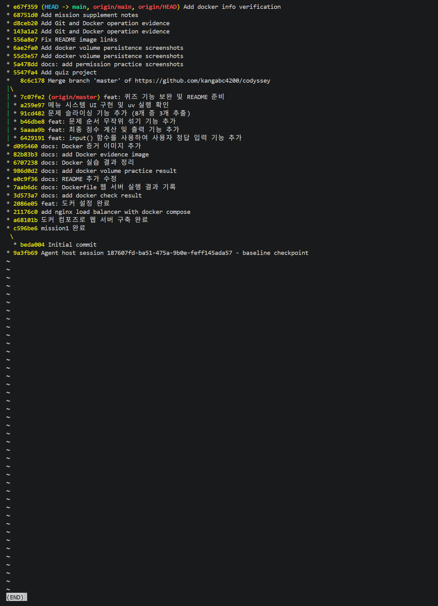 |
|  | 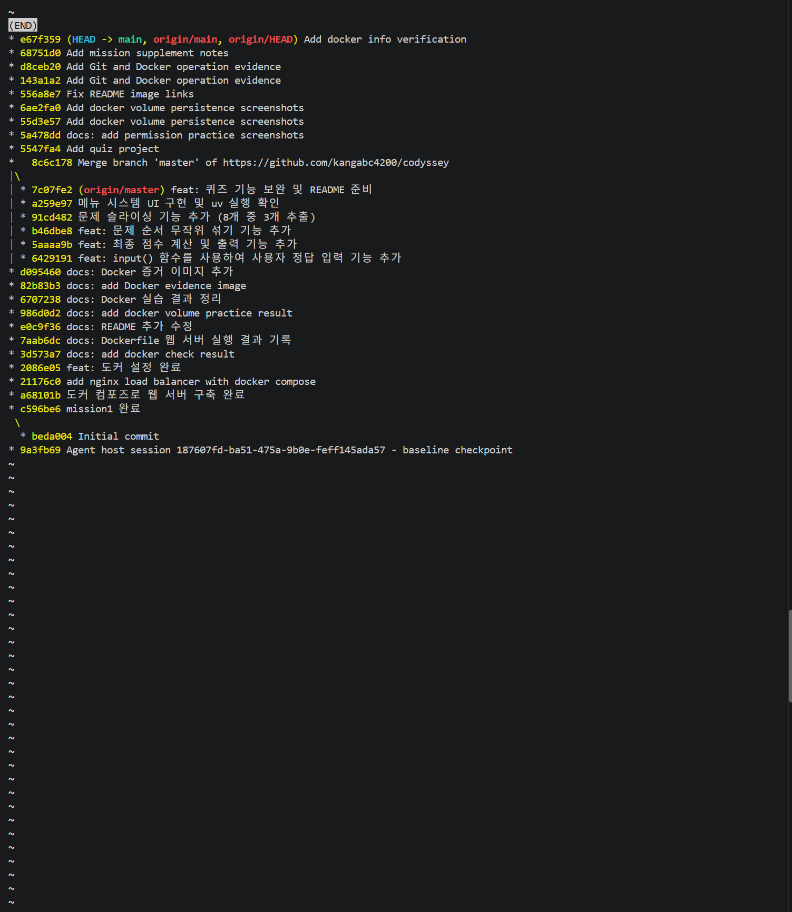 | |

### 2. 원격 저장소 및 클론 테스트
- **원격 저장소 연결 확인**: 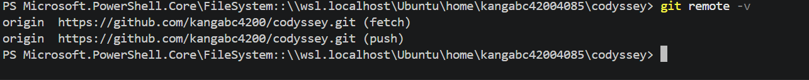
- **Git Clone 테스트 성공**: 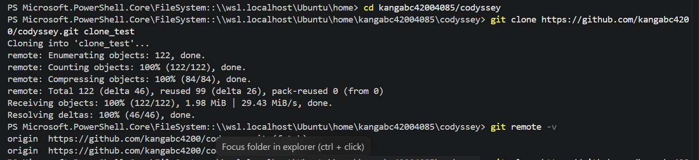
ㄴ

##파이썬 퀴즈 실행과정

- **파이썬 실행 기본 화면**:  
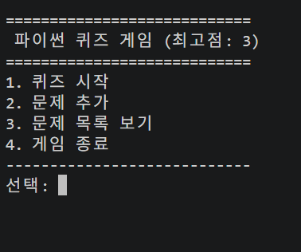
- **선택1.퀴즈시작**:
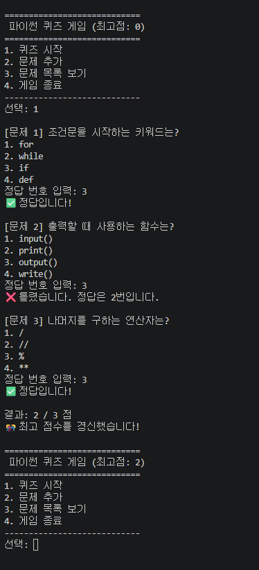
- **선택2.문제추가**

**state.json**
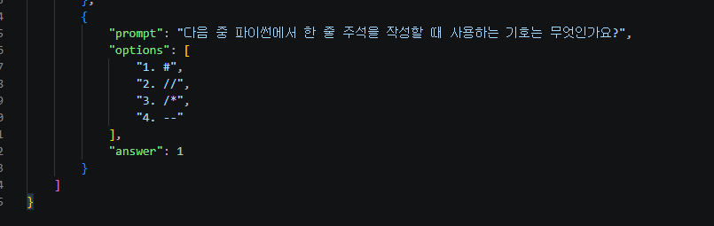
- **선택3.문제목록보기**

- **선택4.개임종료**


### 브랜치 생성 및 병합


# 💡 파이썬 기초 학습 목표 및 핵심 개념
### 변수(Variable)의 개념과 사용 이유
- 변수란? 데이터를 저장하는 메모리 공간의 '이름(상자)'입니다.
- 사용 이유: 동일한 값을 반복해서 사용하거나, 프로그램 실행 중에 변경되는 데이터를 효율적으로 관리하고 코드를 재사용하기 위해 사용합니다.

### 주요 데이터 타입(Data Types)의 차이점
- int (정수): 소수점이 없는 숫자 데이터 (예: 10, -5)
- str (문자열): 따옴표로 둘러싸인 문자의 집합 (예: "Hello", '파이썬')
- bool (불리언): 참(True) 또는 거짓(False)을 나타내는 논리 값
- list (리스트): 여러 개의 값을 순서대로 저장할 수 있는 수정 가능한 목록 (예: [1, 2, 3])
- dict (딕셔너리): 키(Key)와 값(Value)의 쌍으로 데이터를 빠르게 찾고 저장하는 구조 (예: {"name": "김코딩", "age": 20})

### 조건문 (if / elif / else)
- 조건식의 참/거짓 여부에 따라 프로그램의 흐름을 분기하여 서로 다른 동작을 수행하도록 제어합니다.

### 반복문 (for vs while)의 차이와 선택
- for문: 횟수가 정해져 있거나 리스트, 문자열 등의 순회 가능한(Iterable) 데이터 요소를 처음부터 끝까지 반복할 때 주로 사용합니다.
- while문: 특정 조건을 만족하는 동안(조건이 True인 동안) 계속해서 반복을 수행할 때 주로 사용합니다.

### 함수(Function)의 정의와 활용
- 정의: 반복되는 코드에 이름을 붙여 모듈화한 것으로, def 키워드를 사용하여 만듭니다.
- 매개변수(Parameter): 함수 내부로 전달되는 입력값을 받아오는 변수입니다.
- 반환값(Return): 함수가 연산이나 처리를 끝낸 후 결과를 호출부로 돌려주는 값입니다.

# 🏛️ 파이썬 클래스(Class) 및 객체 지향 핵심 학습 목표
### 클래스(Class)의 개념과 사용 이유
- 클래스란? 연관된 데이터(속성)와 기능(메서드)을 하나로 묶어놓은 '설계도' 또는 '틀'입니다. 이를 통해 붕어빵틀에서 여러 개의 붕어빵을 찍어내듯, 동일한 구조의 객체(인스턴스)를 무수히 생성할 수 있습니다.
- 사용 이유:
- 코드의 재사용성: 비슷한 구조의 데이터를 다룰 때 코드를 복사·붙여넣기할 필요 없이 효율적으로 재사용할 수 있습니다.
- 모듈화와 유지보수 용이성: 데이터와 기능을 객체 단위로 묶어 관리하므로(캡슐화), 프로그램의 구조가 명확해지고 수정이나 확장하기가 수월해집니다.

### __init__ 메서드와 self의 역할
- __init__ 메서드 (생성자): 클래스로부터 객체(인스턴스)가 생성될 때 가장 먼저 자동으로 호출되는 특수한 메서드입니다. 주로 객체의 초기 속성값을 설정(초기화)하는 데 사용합니다.
- self: 생성된 자기 자신(인스턴스 객체)을 가리키는 변수입니다. 클래스 내부의 메서드를 정의할 때 첫 번째 인자로 항상 전달되어야 하며, 이를 통해 객체마다 독립적인 속성(데이터)에 접근하고 수정할 수 있습니다.

### 클래스의 속성(Attribute)과 메서드(Method) 정의 및 활용
- 속성 (Attribute): 클래스 내부에 정의된 변수로, 객체가 가지는 고유의 상태나 데이터를 저장합니다. (예: self.name, self.age)
- 메서드 (Method): 클래스 내부에 정의된 함수로, 객체가 수행할 수 있는 동작이나 기능을 구현합니다. (예: def introduce(self): ...)
- 활용: 설계한 클래스로부터 실체(인스턴스)를 생성한 뒤, 객체이름.속성 형태로 데이터를 조회하거나 객체이름.메서드() 형태로 기능을 실행하여 활용합니다.

# 📁 파일 입출력, JSON 및 예외 처리 핵심 학습 목표
파일을 열고(Open), 읽고(Read), 쓰는(Write) 기본 과정
- 과정 개요: 파이썬에서는 open() 함수를 통해 파일을 열고, 모드('r' 읽기, 'w' 쓰기, 'a' 이어쓰기 등)에 따라 내용을 읽거나 기록한 뒤, 작업이 끝나면 반드시 close()로 닫아주어야 합니다.
- Context Manager (with문): with open(...) as file: 문법을 사용하면 파일을 명시적으로 닫지 않아도 블록이 끝날 때 자동으로 파일을 안전하게 닫아주어 자원 관리에 효율적입니다.

### JSON 형식이 무엇이고, 왜 데이터 저장에 사용하는지 설명
- JSON이란? JavaScript Object Notation의 약자로, 키-값(Key-Value) 쌍 구조로 이루어진 가벼운 데이터 교환 형식입니다. 파이썬의 딕셔너리(dict) 구조와 매우 유사하여 호환성이 높습니다.
- 사용 이유: 사람이 읽기 쉽고 직관적일 뿐만 아니라, 언어와 플랫폼에 구애받지 않고 데이터를 표준화하여 저장하거나 네트워크를 통해 전송(직렬화/역직렬화)하기 매우 편리하기 때문입니다.

### try / except를 사용한 오류(예외) 처리
- 개념: 프로그램 실행 중에 에러(예: 파일이 존재하지 않거나, 잘못된 입력 등)가 발생하여 프로그램이 강제로 중단되는 것을 막고, 예외 상황에 유연하게 대처할 수 있도록 제어하는 문법입니다.
- 활용: try 블록 안에는 에러가 발생할 가능성이 있는 코드를 작성하고, except 블록에서 구체적인 예외 상황을 감지하여 적절한 대처 방안(안내 메시지 출력 등)을 실행합니다.

# 🌿 Git 및 버전 관리 핵심 학습 목표
### Git의 개념과 필요성
- Git이란? 소스 코드의 변경 이력을 추적하고 관리할 수 있는 분산 버전 관리 시스템(VCS)입니다.
- 필요성: 코드를 수정하다가 에러가 발생했을 때 이전 상태로 쉽게 되돌릴 수 있고, 여러 사람이 협업할 때 누가 어떤 부분을 언제 수정했는지 명확하게 기록하고 충돌 없이 관리할 수 있습니다.

### 핵심 Git 명령어(init, add, commit, push, pull, checkout, clone)의 역할
- init: 현재 작업 중인 폴더를 Git이 관리하는 로컬 저장소(Repository)로 초기화합니다.
- add: 수정한 파일들을 커밋하기 전, 스테이징 영역(Staging Area)에 올려 변경 내역을 지정합니다.
- commit: 스테이징된 파일들의 변경 사항을 현재 시점의 이력(기록)으로 영구히 저장합니다.
- push: 로컬 저장소에 쌓인 커밋 이력들을 깃허브 등 원격 저장소로 업로드합니다.
- pull: 원격 저장소의 최신 변경 사항을 로컬 저장소로 다운로드하여 병합합니다.
- checkout: 다른 브랜치로 이동하거나 특정 커밋 시점으로 작업 영역을 전환합니다.
- clone: 원격 저장소의 프로젝트 전체를 로컬 컴퓨터로 복제(다운로드)합니다.

### 브랜치(Branch) 생성 및 병합
- 개념: 메인 코드(main/master)를 건드리지 않고 독립적인 공간에서 새로운 기능 개발이나 수정을 수행할 수 있도록 가지를 치는 작업입니다.
- 활용: 새 브랜치를 생성(checkout -b)하여 작업을 완료한 뒤, 메인 브랜치로 돌아와 병합(merge)하여 전체 프로젝트에 반영할 수 있습니다.

### 원격 저장소 활용 (clone과 pull)
- clone: 다른 컴퓨터나 깃허브에 있는 원격 저장소를 내 컴퓨터로 통째로 가져와 개발 환경을 구축할 수 있습니다.
- pull: 다른 사람이 원격 저장소에 수정한 코드를 내 컴퓨터로 동기화하여 항상 최신 상태를 유지하며 협업할 수 있습니다.